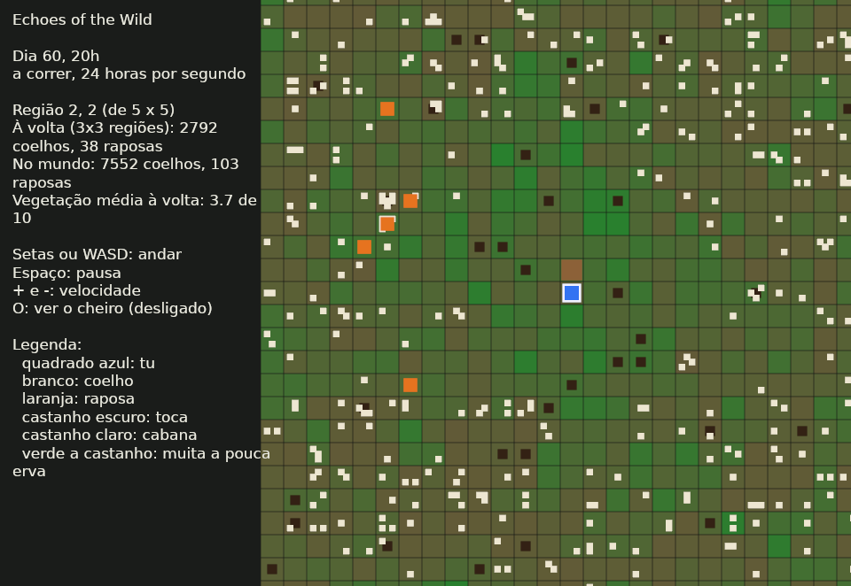

# Diário de Construção: Echoes of the Wild

Aqui registamos o que foi feito, quando, e que marcos foram alcançados, para celebrar cada passo.

**Como funciona:** cada entrada tem a data, o que foi feito, o marco (se houve) e o que se aprendeu.
As entradas mais recentes ficam no topo. Quando um marco acontece, passa a ✅ no painel e ganha uma celebração. 🎉

---

## Painel de marcos

| # | Marco | Estado | Data |
|---|---|---|---|
| 1 | Design congelado (GDD v0.6) | ✅ | 2026-11-01 |
| 2 | Workspace criado (`eotw_sim`, `eotw_cli`, `eotw_game`) | ✅ | 2026-11-01 |
| 3 | Primeira simulação a correr (coelhos e vegetação) | ✅ | 2026-11-01 |
| 4 | Primeiro equilíbrio estável (50 seeds, 300 dias, sem extinções) | ✅ | 2026-11-01 |
| 5 | Primeiro `cargo run` no teu computador | ✅ | 2026-11-02 |
| 6 | Primeiro teste escrito por ti | ✅ | 2026-11-02 |
| 7 | Primeiro predador (raposa) | ✅ | 2026-11-02 |
| 8 | Perceção por cheiro a funcionar | ✅ | 2026-11-02 |
| 9 | Teste da cabana em modo texto | ✅ | 2026-11-02 |
| 10 | Primeira janela com Bevy (etapa 4) | ✅ | 2026-11-02 |
| 11 | O jogador no mundo: os animais fogem dele e do rasto que deixa | ✅ | 2026-11-02 |
| 12 | Performance medida: o mapa de 192x192 cinco vezes mais rápido | ✅ | 2026-11-02 |
| 13 | Região agregada com o mesmo equilíbrio da simulação completa | ✅ | 2026-11-02 |
| 14 | Mundo com várias regiões e animais a passar entre elas | ✅ | 2026-11-02 |
| 15 | Primeira paisagem a andar: a câmara segue o jogador por 25 regiões | ✅ | 2026-11-02 |
| 16 | Etapa 5 completa: ecossistema mínimo, em equilíbrio desde o primeiro dia | ✅ | 2026-11-03 |
| 17 | Prototype 01 completo | ⬜ | |

Os marcos 5 a 10 e o 17 seguem o plano da secção 19 do GDD e podem mudar. Os marcos 11 a 16 foram acrescentados depois, para o trabalho que veio a seguir à primeira janela.

---

## 2026-11-03 (terça-feira)

**O que foi feito**

- O painel de marcos estava parado no marco 10, apesar de o jogador, a performance e a paisagem terem entradas próprias. Ganharam marcos: do 11 ao 15. O "Prototype 01 completo" passou a ser o 16.

**Marcos** 🎉

- Marco 11: **o jogador no mundo**. Os coelhos e as raposas fogem dele, e as raposas evitam o rasto que ele deixa. 🧍
- Marco 12: **performance medida**. O mapa de 192x192 passou de 15 ms para 3 ms por tick, com resultados iguais byte a byte. ⏱️
- Marco 13: **região agregada**. Reproduz o equilíbrio da completa (281 coelhos contra 276) e recupera de choques à mesma velocidade. 📊
- Marco 14: **mundo com várias regiões**. Os animais passam de região em região, e uma região vazia volta a encher-se. 🗺️
- Marco 15: **primeira paisagem a andar**. A câmara segue o jogador por 25 regiões, e o que ele vê é sempre simulado animal a animal. 🎥

**Próximo passo:** correr `cargo run --release -p eotw_game`, atravessar fronteiras de região e ver se há soluços, animais a aparecer ou a desaparecer à vista, e como corre a 240 horas por segundo.

### O lag da paisagem 🐢→🐇

**O que viste:** lag no jogo em release, mesmo em pausa e parado. Por isso a causa não era a simulação.

**Como se encontrou a causa.**
- **Uma opção para medir:** o jogo ganhou a opção `--frames N`. Corre N frames sem esperar pelo ecrã, escreve a mediana e o pior tempo por frame, e sai.
- **Desligar um sistema de cada vez:** desliguei cada sistema de desenho à vez, e apareceram duas causas.

**Causa 1: os animais eram apagados e criados em cada frame.**
- **O que acontecia:** em cada frame, o jogo apagava e voltava a criar uma entidade do Bevy por cada coelho, raposa e toca à vista. Com centenas de coelhos, isso levava a maior parte do frame: 22 ms de mediana, contra 5 ms sem desenhar os animais.
- **Correção:** os sprites passaram a ser sempre os mesmos. Em cada frame mudam de sítio, cor e tamanho, e os que sobram escondem-se, como já se fazia com os quadrados do chão.
- **Mexer só no que mudou:** os quadrados e o texto do painel também só se alteram quando mudam, porque cada alteração obriga o Bevy a voltar a enviar tudo para a placa gráfica.
- **Teste:** `os_sprites_dos_animais_reaproveitam_se`.

**Causa 2: a placa NVIDIA tinha soluços próprios.**
- **O que acontecia:** a MX250, com o controlador NVK, tinha um soluço de cerca de 33 ms a cada 20 frames, mesmo sem nada para desenhar.
- **Correção:** a placa Intel integrada não tem esses soluços, e para um jogo 2D chega bem. O jogo passou a escolhê-la por omissão. Com `WGPU_POWER_PREF=high` usa-se a NVIDIA.

**Resultado** (release, 240 horas por segundo, 1800 frames):

| | Frame mediana | 95% dos frames abaixo de | Pior frame |
|---|---|---|---|
| antes (NVIDIA, sprites novos em cada frame) | 17 a 22 ms | 32 ms | 43 ms |
| sprites reaproveitados, NVIDIA | 7,2 ms | 32 ms | 34 ms |
| sprites reaproveitados, Intel (por omissão) | 3,9 ms | 5,2 ms | 7,9 ms |

**Também mudou no jogo:**
- **O painel mostra a performance:** os frames por segundo e o pior tempo da simulação, renovados duas vezes por segundo.
- **`--speed N`:** começa a N horas de jogo por segundo.
- **Capturas de ecrã:** passaram a esperar 2 segundos em vez de 30 frames. Em release, 30 frames passavam antes de a letra carregar.



**O que se aprendeu**

1. **Medir antes de adivinhar.** Pela medição feita sem janela, a simulação gastava 1,4 ms por frame, por isso o lag tinha de estar no desenho. Mas só desligar cada parte mostrou que eram duas causas, e que uma delas nem era do nosso código.
2. **Criar e apagar entidades é caro no Bevy.** Mudar uma entidade que já existe é muito mais barato.

**Teste em jogo:** a jogar normalmente, com vsync, a Intel deu 176 a 180 frames por segundo, sem lag. A NVIDIA ficou nos 20 frames por segundo, muito pior do que nas medições sem vsync. Fica confirmado que a Intel é a escolha certa por omissão. A NVIDIA só volta a ser opção se o controlador NVK melhorar.

### Histerese nas fronteiras ↔️

**O problema:** a janela deslocava-se logo que o jogador mudava de região. Quem andasse para trás e para a frente em cima de uma fronteira fazia a janela andar a cada passo. Em cada deslocamento, as regiões que saem são agregadas e as que entram são expandidas: custa cerca de 0,6 ms e baralha os animais dessas regiões sem necessidade.

**A solução:** a janela guarda a região do meio (`centre`) e só se desloca quando o jogador já entrou mais de 4 células (`HYSTERESIS`) numa região vizinha. Para voltar atrás, vale o mesmo. Em troca, o jogador pode ficar 4 células mais perto da margem da janela: a margem fica agora a 20 células ou mais dele (`WINDOW_MARGIN`), em vez de 24. Continua a ser mais do que as 8 de `SPAWN_CLEAR_RADIUS` e do que meia vista do jogo (15 células), o que é verificado ao compilar.

**Medição** (2000 passos ao acaso, numa paisagem de 5x5 regiões):

| | Deslocamentos antes | Deslocamentos agora |
|---|---|---|
| passeio ao acaso | 42 | 7 |
| para trás e para a frente, a começar em cima de uma fronteira | 105 | 13 |

**Testes novos:**
- `andar_em_cima_da_fronteira_nao_desloca_a_janela`: 4 passos para lá e 4 para cá, 10 vezes, e a janela não se mexe; com o quinto passo desloca-se, e não volta para trás ao regressar à fronteira.
- `o_jogador_fica_longe_da_margem_da_janela`: em 3000 passos ao acaso, o jogador nunca fica a menos de 20 células da margem da janela (a não ser nas margens da paisagem).

### Mais raposas na janela 🦊

**O que se via:** a janela tinha 8,5 raposas por região e as agregadas 6,5. Pensei que vinha do tamanho do mapa, porque um mapa de 48x48 também dava 8,5.

**O que era:** as medições paravam cedo demais. As raposas vivem 400 dias, e as medições, e a tabela das crias de raposa, iam só até ao dia 300 depois do aquecimento. Nessa altura ainda nenhuma raposa tinha morrido de velhice e a população ainda estava a subir. Medindo até ao dia 1200:

| Por região, dias 500 a 1200 | Raposas |
|---|---|
| um mapa de 24x24 isolado | 11,4 |
| um mapa de 72x72 | 10,4 |
| na janela da paisagem | 11,3 |
| nas agregadas da paisagem | 7,9 |

Só as agregadas estavam erradas, porque a tabela delas tinha sido medida antes do equilíbrio.

**Porque a tabela antiga não servia:** com o mesmo número de raposas, há mais crias em equilíbrio do que no início. Com 7 raposas por região, há 0,0053 crias por raposa por dia em equilíbrio, contra 0,0026 no início. No início, as raposas descendem todas das mesmas duas e estão juntas: cada uma tem rivais no seu território, e com rivais por perto há menos crias. Em equilíbrio já estão espalhadas.

**A correção:** a tabela `fox_births` foi medida de novo em cada região de 24x24 de 8 mapas de 72x72, entre os dias 500 e 1500. As crias de cada dia contam-se na região onde nascem.

| Por região, dias 500 a 1200 | Antes | Agora |
|---|---|---|
| na janela | 11,3 | 11,5 |
| nas agregadas | 7,9 | 10,5 |

**Testes:** `a_agregada_tem_o_mesmo_equilibrio_que_a_completa` e `uma_regiao_maior_tem_o_mesmo_equilibrio` passaram a comparar os dias 500 a 900, em vez de 40 a 300. Num mapa de 24x24, a completa fica com 10,9 raposas e a agregada com 10,8. Num de 48x48, com 37,6 e 43,9 (17% a mais, dentro da tolerância de 25%).

**O que se aprendeu**

1. **Medir até ao equilíbrio de todos.** Os coelhos chegam ao equilíbrio em semanas, mas as raposas só depois da primeira geração morrer de velhice. Uma medição que acaba antes disso compara o arranque e não o equilíbrio.
2. **A densidade não diz tudo.** As crias de raposa dependem também de como as raposas estão espalhadas, e isso muda muito entre o início e o equilíbrio.

**O que ainda falta**

- **O jogo começa longe do equilíbrio das raposas:** cerca de 4 por região, e só chegam às 10 ou 11 ao fim de cerca de 600 dias de jogo (10 minutos a 24 horas por segundo). Um aquecimento mais longo, ou mais raposas ao começar, resolve isto.

**Próximo passo:** os pontos que ainda estão em aberto: o arranque longe do equilíbrio das raposas, as falhas no rasto a velocidade baixa e o determinismo de `exp` entre plataformas.

---

### O arranque em equilíbrio e o fim da etapa 5 🏁

**O problema:** o jogo começava com cerca de 4 raposas por região, e elas só chegavam às 10 ou 11 ao fim de uns 600 dias de jogo.

**A solução:** antes de o jogador chegar, a paisagem corre 600 dias (`WARMUP_DAYS`) só com regiões agregadas, com animais a passar entre elas. Só depois se expande a janela. Agregadas, as 25 regiões correm esses 600 dias em cerca de 100 ms: criar a paisagem do jogo passou de 530 para 630 ms. O jogo começa agora no dia 660 do mundo.

**Resultado** (paisagem do jogo, 5x5 regiões, 4 seeds):

| Raposas por região | No dia em que o jogador chega | 250 dias depois | 500 dias depois |
|---|---|---|---|
| na janela | 10,7 | 11,1 | 11,4 |
| nas agregadas | 10,3 | 10,2 | 10,1 |

Os coelhos ficam entre 267 e 277 por região durante esse tempo.

**Teste novo:** `a_paisagem_comeca_em_equilibrio`: logo ao criar a paisagem, a janela e as agregadas têm entre 8 e 14 raposas por região.

**Marco 16** 🎉: **etapa 5 completa**. O ecossistema mínimo do GDD está feito: presas e predadores, comida que acaba e volta a crescer, populações que reagem a ela, vários níveis de detalhe e a performance medida. E agora está em equilíbrio desde o primeiro dia em que o jogador chega.

**O que ficou em aberto, mas não é da etapa 5:** as falhas no rasto a velocidade baixa e o determinismo de `exp` entre plataformas.

**Próximo passo:** etapa 6 (sobrevivência e construção), a começar pelo dia e noite.

## 2026-11-02 (segunda-feira)

**O que foi feito**

- O projeto compilou e correu no teu computador.
- Escreveste o teu primeiro teste: `sem_vegetacao_os_coelhos_morrem_de_fome`.
- Na primeira versão o teste falhou: os coelhos passaram de 20 para 120. Corrigido ao desligar o crescimento da vegetação nesse teste.

**Marcos** 🎉

- Marco 5: **primeiro `cargo run` no teu computador**. 💻
- Marco 6: **primeiro teste escrito por ti**. 🧪

**O que se aprendeu**

1. **Um teste que falha também ensina:** esvaziar o mundo uma vez não chega, porque o `seed_growth` faz a vegetação voltar a crescer. Ao fim de cerca de um dia e meio as células já passam o `min_food`, antes de os coelhos morrerem de fome.
2. **Configurar só o que interessa:** `Config { vegetation: VegetationParams { regrowth: 0.0, seed_growth: 0.0, ..VegetationParams::default() }, ..Config::default() }` altera dois valores e mantém todos os outros por omissão.

**Próximo passo:** acrescentar a raposa (marco 7).

### Mais tarde, no mesmo dia: a raposa 🦊

**O que foi feito**

- Nova espécie em `eotw_sim/src/fox.rs`: a raposa vê coelhos até 5 células, persegue-os a 2 células por tick e salta quando chega ao lado. Depois de comer fica saciada.
- O coelho agora foge: corre para a toca mais próxima ou, se não houver nenhuma perto, para longe da raposa.
- Tocas no mapa (`o` no mapa de texto): dentro de uma toca o coelho não se vê nem se pode caçar. A vegetação densa também protege.
- Território: uma raposa só tem crias se não houver outra raposa a 9 células ou menos.
- Migração de segurança (GDD 7.8, mecanismo 6): se uma espécie desaparecer durante 3 dias, chega um animal pela margem do mapa. Fica registada no relatório.
- CSV e tabela do `eotw_cli` com colunas novas: caçados, raposas, crias e mortes de raposas, migrações.
- 28 testes (eram 13), incluindo o teste de equilíbrio predador-presa da GDD 18.6: 20 seeds, 100 dias.

**Marco** 🎉

- Marco 7: **o primeiro predador**. Pela primeira vez, a cadeia vegetação → coelhos → raposas funciona: com raposas há menos coelhos e mais vegetação. Em 70 seeds com 300 dias, e em 20 seeds com 1000 dias, as duas espécies coexistem **sem uma única migração de segurança**. 🦊🐇🌱

**O que se aprendeu**

1. **A perseguição infinita:** na primeira versão as raposas quase nunca caçavam. A raposa parava ao lado do coelho, o coelho afastava-se uma célula, e repetiam isto para sempre. A solução foi a raposa saltar logo no mesmo tick em que chega ao lado.
2. **O ciclo de expansão e colapso (GDD 7.8 tinha razão):** as raposas multiplicavam-se até cerca de 20, comiam todos os coelhos e depois morriam de fome. As tocas e o território ajudaram, mas não chegaram.
3. **O medo também mata:** a dada altura morriam mais coelhos de fome do que caçados, com a vegetação quase cheia à volta. Estavam escondidos ou a fugir em vez de comer. A solução foi o coelho esfomeado arriscar e ir comer (`desperate_energy`). É a IA de utilidade da GDD 17.3 em versão pequena.
4. **O parâmetro decisivo foi a gula da raposa:** passar `hunt_below` de 85 para 65 (a raposa só caça quando tem fome a sério), com 30 tocas e 2 raposas iniciais, transformou um sistema que colapsava num que coexiste. Mais uma vez, um número pequeno decidiu entre vida e extinção.
5. **Testar muitas seeds de uma vez vale ouro:** um programa à parte corria 20 a 70 seeds com várias combinações de parâmetros em segundos, e mostrava logo qual era a mais robusta.

**Revisão do código (no mesmo dia)**

- O teu teste da fome deixou de isolar a fome: com raposas no `Config::default()`, podia passar só porque os coelhos foram caçados. Agora usa `Config::without_foxes()` e verifica também que `deaths_hunger` é maior que zero.
- As crias nasciam com 30 de energia, que é exatamente o limiar `desperate_energy`, por isso nunca fugiam. Foi acidente: agora nascem com 35 e há um teste (`cria_foge_desde_que_nasce`).
- As tocas eram criadas depois das raposas, por isso mudar `initial_foxes` mudava o sítio das tocas e estragava a comparação com/sem raposas. Passaram para antes. Isto mudou os resultados (uma seed em 70 voltou a precisar de migração); com as crias a 35 voltou a 70/70 sem migrações em 300 dias e 20/20 em 1000 dias.
- `rust-version = "1.82"` no `Cargo.toml`, para o Cargo dizer claramente quando o Rust está desatualizado.
- Fica para os chunks: `nearest_rabbit` e `nearest_burrow` percorrem listas inteiras. Chega para um mapa de 24×24, mas vai precisar de uma grelha espacial.

**Lição:** uma revisão de fora vê o que quem escreveu já não vê. E mudar a ordem em que se usa o `Rng` muda o mundo todo: depois de qualquer mudança dessas, volta-se a correr os testes de equilíbrio.

**Próximo passo:** perceção por cheiro (marco 8). A raposa passa a seguir o rasto dos coelhos em vez de só os ver.

### Ao fim do dia: arrumação e arte 🎨

**O que foi feito**

- **Hardlinks quebrados.** Os ficheiros de fora e os da subpasta `echoes-of-the-wild/` eram o mesmo ficheiro com dois nomes. Um `cp` seguido de `mv` em cada um tornou-os independentes, e a subpasta repetida passou a ser só uma cópia antiga, que se pode apagar.
- **GDD v0.7** com a nova secção 15.5, *Ideias de arte (inspiração, não decisões)*: sete referências de arte e o que têm em comum (pintura em vez de realismo, escala e figuras pequenas, ruínas recuperadas pela natureza, marcos visíveis ao longe, luz como protagonista, paleta contida com um acento, fantasia moderada). A decisão visual continua adiada.

**O que se aprendeu**

1. **Dois nomes para o mesmo ficheiro pregam partidas:** editar um muda o outro, e ferramentas que querem evitar ler "por um atalho" recusam-se a abri-lo.
2. **A arte também empurra a simulação:** nenhuma referência mostra animais pequenos, por isso coelhos e raposas vão precisar de silhuetas e cores que se leiam à distância (ligação à legibilidade, GDD 7.10).

### Segunda revisão: as margens do equilíbrio 📏

A revisão mostrou que o equilíbrio era estável, mas com margens estreitas: `hunt_below` 65 estava a 5 pontos de um colapso, 3 ou mais raposas iniciais faziam os coelhos descer a 2, e um mapa de 16×16 colapsava.

**O que foi feito**

- **As varreduras passaram para o projeto.** `cargo run --release -p eotw_cli -- --sweep` corre cada parâmetro sensível de um lado ao outro com 40 seeds (módulo `sweep.rs`). Há um teste novo, `margens_de_equilibrio`, que falha se os valores por omissão ficarem perto de uma beira: `hunt_below` ±10, 1 raposa, o triplo das raposas, um terço das tocas e o mapa mínimo.
- **As raposas chegam no dia 30, e o jogador no dia 60.** Antes disso só há coelhos (`foxes_arrive_day`), e `Simulation::warmed_up` corre os primeiros 60 dias antes de o jogador aparecer (`warmup_days`).
- **`hunt_below` passou de 65 para 60,** o meio da nova zona estável.
- **Tamanho mínimo de região: 24×24** (`MIN_REGION_SIZE`), escrito na GDD 7.9.
- **O teste da cabana existe antes do cheiro.** Há restos de comida no mundo, que coelhos e raposas comem se pisarem a célula, e uma cabana opcional (`CabinParams`) cuja comida é reposta todos os dias. Cada espécie tem um contador de entradas na zona. O teste `comida_junto_a_cabana_atrai_animais` está marcado com `#[ignore]` até ao marco 8.
- **O "território" da raposa tem o nome certo nos comentários e na GDD:** é um travão de densidade, não um território que ela ocupe.

| Varredura (40 seeds, 300 dias) | Antes | Depois |
|---|---|---|
| `hunt_below` estável | 50 a 65 (70 colapsa) | 40 a 75 (80 colapsa; a 1000 dias, 50 a 70) |
| Raposas iniciais estáveis | 1 a 2 | 1 a 8 |
| Tocas estáveis | 10 a 40 (0 colapsa) | 0 a 40 |
| Mapa estável | 24×24 ou mais | 20×20 ou mais |

**Ponto de partida do teste da cabana (sem cheiro)**, com `eotw_cli --cabin`, 20 seeds e 120 dias depois de o jogador chegar:

- coelhos: 17 550 visitas sem comida e 17 538 com comida (×1,00);
- raposas: 21 visitas sem comida e 24 com comida (×1,14), um número demasiado pequeno para tirar conclusões.

É este o número que o cheiro tem de melhorar.

**O que se aprendeu**

1. **A sensibilidade não era às raposas, era ao arranque.** Com 20 coelhos no dia 0, poucas raposas a mais comiam-nos antes de se reproduzirem. Com só 20 dias de avanço para os coelhos, 2 a 8 raposas ficaram todas estáveis, mesmo com a migração desligada. O problema não estava onde parecia.
2. **Um valor que funciona pode estar à beira do precipício.** Os testes de equilíbrio passavam com 65, mas 67,5 já colapsava. Saber onde estão as beiras vale tanto como saber que o valor por omissão funciona.
3. **Perto da capacidade de carga, a raposa troca uma morte por outra.** Com raposas há só 1 a 9% menos coelhos, mas as mortes por fome caem de cerca de 2,2 para 1 por dia: muitos dos coelhos caçados teriam morrido de fome na mesma. O teste `as_raposas_reduzem_os_coelhos` teve de passar a medir a partir do dia 100, quando já há raposas suficientes para a diferença se ver.
4. **Sem cheiro, a comida junto à cabana não atrai ninguém.** Os coelhos já estão por todo o lado, e as raposas descansam quase sempre e raramente passam lá. Agora sabemos que qualquer diferença que apareça depois vem do cheiro.
5. **Com 2 a 8 raposas, perde-se uma por azar de vez em quando.** A 1000 dias, cerca de 1 seed em 20 precisa de uma migração de raposa, seja qual for o `hunt_below` entre 45 e 70. Não é um limiar: é o que acontece com populações tão pequenas, e é para isso que serve a migração.

**Fica para depois**

- Em duas seeds (3 e 4) as duas raposas iniciais nunca têm crias em 250 dias, provavelmente porque andam sempre a menos de 9 células uma da outra. Vale a pena investigar.
- `cargo test` demora cerca de 30 segundos por causa das varreduras em modo debug. Se começar a incomodar, `opt-level = 1` no perfil de teste resolve.

**Próximo passo:** perceção por cheiro (marco 8). Fica feito quando `comida_junto_a_cabana_atrai_animais` passar sem o `#[ignore]`.

### Já de noite: o cheiro 👃

**O que foi feito**

- **Campos de cheiro** (`scent.rs`, GDD 7.6): uma grelha por tipo, por agora *alimento* (restos) e *presa* (coelhos). As fontes depositam cheiro na sua célula, e em cada tick o cheiro espalha-se para as vizinhas e decai 1%. Um coelho dentro da toca não deixa cheiro, por isso a toca continua a ser refúgio.
- **O coelho com fome** vai primeiro para a erva que vê. Só segue o cheiro dos restos se nenhuma vizinha tiver comida que chegue, e sente-o até cerca de 7 células.
- **A raposa que não vê nenhum coelho** segue primeiro o cheiro de restos, depois o de coelhos, e só deambula se não sentir nada. Também come os restos.
- **O teste da cabana passou, já sem o `#[ignore]`.** Mede horas na zona em vez de entradas.
- **`cargo test` passou de 73 para 6 segundos** com `opt-level = 2` no perfil de teste.

**Marco** 🎉

- Marco 8: **os animais encontram comida que não veem.** Com 10 restos por dia, os coelhos passam mais tempo junto à cabana em 20 de 20 seeds (×1,15 com 10 restos, ×1,44 com 30, ×1,75 com 50), e as raposas ×2,7. Uma raposa que encontra a cabana fica lá a comer os restos e a caçar os coelhos que vêm pela comida: a cadeia coelho, raposa aparece sem ter sido escrita.

**O que se aprendeu**

1. **Medir antes valeu a pena.** Sem cheiro a diferença era ×1,00, por isso o que aparece agora vem do cheiro.
2. **A pergunta do teste estava errada duas vezes, e foi corrigida às claras.**
   - **Entradas → horas.** As entradas de raposas *desciam* com comida, porque a raposa chega e fica.
   - **O ×1,5 dos coelhos era um número inventado antes de haver dados.** Os dados mostram um efeito pequeno mas sempre presente e proporcional à comida. O teste passou a pedir isso: sobe em todas as seeds e sobe mais com mais comida. Para as raposas continua a ser ×1,5 no total.
3. **Uma armadilha ecológica.** Na primeira versão, com 50 restos por dia, os coelhos caíam para 10 em todo o mapa. Os restos acabavam em poucas horas, mas o cheiro durava dias: os coelhos ficavam presos à volta da cabana, em células rapadas, a morrer de fome com erva cheia a duas células. A correção foi o coelho confiar primeiro na erva que vê. Há um teste novo, `muita_comida_nao_e_uma_armadilha`, e agora mais comida dá mais coelhos (311 com 200 restos por dia, contra 280 sem comida).
4. **O equilíbrio aguentou o cheiro:** a varredura dá os mesmos resultados de antes.

**Fica para depois**

- A raposa só encontra a cabana em cerca de 1 seed em 4, porque quase sempre vê um coelho antes de cheirar a comida. Uma raposa que prefira restos fáceis a uma caçada podia mudar isso.
- O marco 9 (teste da cabana em modo texto) já mede o que a GDD pede às visitas, com `eotw_cli --cabin`. Falta o registo de uma sequência de eventos encadeados, que na GDD inclui o lobo.

**Próximo passo:** decidir entre fechar o marco 9 (eventos encadeados no registo) e afinar a raposa necrófaga.

### A raposa necrófaga 🦴

**O que foi feito**

- **A raposa é necrófaga.** Com fome e um cheiro forte de restos (`scavenge_smell_min`), vai aos restos mesmo que veja um coelho: comer restos não custa nada.
- **`sniff` deixou de gastar números do `Rng` quando não há cheiro.** Assim um mundo sem cabana não é alterado por um cheiro que não existe.
- **Dois testes novos:**
  - `raposa_necrofaga_prefere_restos_a_caca`;
  - `necrofagia_nao_esteriliza_as_raposas`.

**Com 10 restos por dia, 20 seeds e 60 dias, segundo o limiar:**

| Limiar | As raposas vêm à cabana | Os coelhos sobem | Raposas a 1000 dias com 50 restos |
|---|---|---|---|
| desligado | 3/20 seeds | 20/20 | média 9, 0 migrações |
| **8 (escolhido)** | 7/20 (19/20 com 50 restos) | 18/20 | média 7, 0 migrações |
| 2 | 16/20 | 14/20 | média 2,4, 16 migrações |
| 1 | 20/20 | 12/20 | média 2, 18 migrações |

**O que se aprendeu**

1. **A raposa na cabana afasta os coelhos.** Quanto mais necrófaga, mais vezes acampa junto à comida, e os coelhos fogem dela. É uma consequência que o jogador consegue ler ("desde que a raposa vem cá, os coelhos desapareceram"), mas em excesso apaga o efeito da comida nos coelhos.
2. **O travão de densidade tem um ponto cego.** Quando todas as raposas se juntam num sítio com comida, cada uma tem rivais perto e nenhuma tem crias, mesmo bem alimentadas. A população envelhece e só a migração a repõe. O travão conta vizinhas, não comida disponível. É um argumento para o território verdadeiro do lobo e, talvez, para um travão que olhe também para a comida.
3. **Os casos de beira mudam com qualquer coisa.** Só por mudar a sequência do `Rng`, "raposas chegam no dia 0" e o mapa de 16×16 passaram a precisar de migração em algumas seeds. Já tinham trocado de estado em varreduras anteriores. É por isso que os valores por omissão ficam longe dessas beiras.

**Próximo passo:** fechar o marco 9, com eventos encadeados no registo (coelho, raposa, e um dia o lobo).

### O registo da cabana e o marco 9 📜

**O que foi feito**

- **Registo da cabana** (`CabinLog`) com frases legíveis e a hora, por exemplo:
  - "Dia 62, 09h: um coelho comeu os restos junto à cabana."
  - "uma raposa seguiu o cheiro dos restos até à cabana."
  - "uma raposa caçou um coelho junto à cabana."
- **Deteção de cadeias:** um coelho come os restos e, em menos de 2 dias, uma raposa caça junto à cabana. A raposa pode ter vindo atrás ou já lá estar à espera, e o registo diz qual foi.
- **`eotw_cli --cabin`** mostra as cadeias por seed e o registo da primeira história com cadeia.
- **Teste `a_cadeia_da_cabana_acontece_sem_ser_escrita`:**
  - há cadeias;
  - variam entre seeds;
  - com comida há mais caçadas junto à cabana do que sem comida.

**Marco** 🎉

- Marco 9: **o teste da cabana corre em modo texto e cumpre a GDD 18.6.**
  - **Mais tempo junto à cabana com comida:** coelhos ×1,12, raposas ×3,35.
  - **Há cadeias que ninguém escreveu:** 36 em 7 de 20 seeds, em 60 dias depois de o jogador chegar.
  - **Os resultados variam entre seeds:** de 0 a 7 cadeias por seed.
  - **A comida causa mais caçadas junto à cabana:** 26 sem comida, 49 com comida.
  - **O lobo da cadeia da GDD** fica para quando houver lobo.

**O que se aprendeu**

1. **Uma cadeia contada não é uma cadeia causada.** À primeira, as "cadeias" eram coincidências: havia caçadas junto à cabana com ou sem comida. Só o controlo a sério (caçadas com comida contra sem comida) o mostrou: com comida havia *menos* caçadas, 14 contra 26. Sem esse controlo, o marco tinha fechado com uma causalidade falsa.
2. **O valor de um resto muda o jogo.** Com 10 de energia por unidade, 10 restos por dia valiam 2 coelhos. A raposa enchia-se e deixava de caçar, e a comida protegia os coelhos. É a alimentação de diversão, que existe na ecologia real. Com 2, os restos são um petisco: atraem a raposa, que depois caça os coelhos que vieram pela comida (×1,9 caçadas). Escolhi 2 porque é a cadeia que a GDD descreve. Fica como ideia de jogo: restos de carne (muito nutritivos, protegem as presas) e restos de vegetais (atraem coelhos e, por arrasto, raposas).
3. **A definição da cadeia também estava estreita demais.** Exigia que a raposa *chegasse* depois do coelho, mas quase todas as caçadas eram de raposas que já estavam acampadas na cabana. A causa é a mesma (foi a comida que as trouxe), por isso as duas contam.

**Fica para depois**

- **O ponto cego do travão de densidade piorou com comida em excesso.** Com 200 restos por dia, as raposas juntam-se todas na cabana e deixam de ter crias: ficam em média 2, com 38 migrações em 20 seeds e 1000 dias. Com o valor antigo já eram 19. Com 10 restos por dia não há problema. A solução é um travão que conte com a comida disponível, ou o território verdadeiro.

**Próximo passo:** o travão de densidade com comida, ou começar a etapa 4 (primeira janela com Bevy, marco 10).

### O travão de densidade com comida, e a raposa que debicava 🍖

**O que foi feito**

- **O travão de densidade conta com a comida.** Cada 40 de energia em restos dentro do raio dá lugar a mais uma raposa rival (`scrap_energy_per_extra_fox`).
- **Com restos aos pés, a raposa come até estar cheia** (`full_energy` 95), mesmo sem fome.
- **Os restos valem 0,5 de energia por unidade para a raposa** (eram 2).
- **Dois testes novos:**
  - `raposa_com_restos_come_ate_estar_cheia`;
  - `muita_comida_nao_esteriliza_as_raposas`, que substitui o da necrofagia e testa 50 e 200 restos por dia.

**Com 200 restos por dia, 20 seeds e 1000 dias:**

| Versão | Raposas em média | Migrações |
|---|---|---|
| Antes | 2,0 | 38 |
| Só o travão com comida | 2,5 | 33 |
| Só comer até estar cheia | 2,2 | 20 |
| As duas | 16,7 | 0 |
| As duas, com restos a 0,5 (final) | 4,8 | 0 |

**O que se aprendeu**

1. **O diagnóstico de ontem estava incompleto.** Achei que o problema era só o travão de densidade, mas corrigi-lo quase não mudou nada. Ao seguir as raposas de uma seed, a energia delas estava sempre entre 60 e 64. Só comiam restos com fome (abaixo de 60), cada dentada dava +4, e paravam: debicavam para sempre logo acima do limiar e nunca chegavam aos 75 para ter crias. Eram precisas as duas correções, e nenhuma resolvia sozinha.
2. **Corrigir um comportamento muda outro.** Uma raposa que come até estar cheia é alimentada pela cabana e deixa de caçar lá (3 caçadas com comida, contra 26 sem). A alimentação de diversão voltou. Baixar os restos para 0,5 tornou-os outra vez um petisco: 48 caçadas com comida, 20 cadeias em 7 de 20 seeds.
3. **Medir em energia e não em unidades.** O travão diz quanta energia em restos justifica mais uma raposa. Assim, se o valor dos restos mudar outra vez, o travão continua coerente.

**Próximo passo:** começar a etapa 4 (primeira janela com Bevy, marco 10).

### Arrumação, git e a primeira janela 🪟

**O que foi feito**

- **A cópia antiga `echoes-of-the-wild/` foi apagada,** depois de confirmar que só tinha versões mais antigas dos mesmos ficheiros.
- **`git init` e primeiro commit** (`4b4846f`).
- **`eotw_game` com Bevy 0.16.** A janela desenha a simulação de `eotw_sim`, que continua sem saber que o Bevy existe:
  - a vegetação, de castanho (pouca erva) a verde (muita);
  - as tocas, os coelhos, as raposas e a cabana;
  - um painel com o dia, as populações, a legenda e as últimas linhas do registo da cabana.
- **Teclas:**
  - Espaço: pausa;
  - `+` e `-`: velocidade, de 1 a 240 horas de jogo por segundo.
- **Opções:** `--seed`, `--cabin` e `--screenshot FICHEIRO`. Esta última guarda uma imagem da janela e fecha, e foi assim que se tirou a imagem `docs/janela_marco10.png`.
- **Fonte DejaVu Sans em `eotw_game/assets/fonts`,** com a licença ao lado. A fonte do Bevy não tem acentos, e "Vegetação" aparecia com quadrados.
- **`rust-version` passou para 1.85,** o mínimo do Bevy 0.16.

**Marco** 🎉

- Marco 10: **o ecossistema tem cara.** Pela primeira vez vê-se o mundo a mexer: os coelhos espalhados pela erva, as raposas a laranja, e a erva a ficar castanha onde os coelhos comem.

**O que se aprendeu**

1. **A primeira compilação do Bevy demora:** 25 minutos neste portátil. As seguintes recompilam só o nosso código (cerca de 25 segundos). O `target/` fica grande, porque o executável em modo debug tem 1,3 GB com a informação de depuração.
2. **Escolhi o Bevy 0.16 e não o mais recente (0.20).** É a versão cuja API conheço com segurança. Atualizar é um passo a planear à parte, porque o Bevy muda a API em cada versão.
3. **Separar a simulação do motor compensa já:** o jogo tem cerca de 300 linhas e só desenha. Toda a ecologia, os testes e as varreduras continuam em `eotw_sim`.

**Verificado por ti:** a janela abre e fecha sem erros, e a pausa e a velocidade funcionam.

**Próximo passo:** etapa 4, a seguir: o jogador e o movimento.

### O jogador entra no mundo 🧍

**O que foi feito**

- **O jogador vive na simulação, não só no desenho** (`Simulation::player`, `place_player`, `move_player`). Os animais reagem a ele:
  - os coelhos tratam-no como uma ameaça, tal como uma raposa;
  - as raposas afastam-se se ele estiver a 4 células ou menos, mesmo com fome (`human_fear`, GDD 3.1: o jogador pode afugentar um predador).
  - Sem jogador no mapa, a simulação é exatamente a de antes, por isso os testes de equilíbrio e as varreduras não mudaram.
- **Na janela:** o jogador é o quadrado azul e começa ao lado da cabana. Anda com as setas ou WASD, também em pausa. As setas deixaram de mudar a velocidade: agora é só `+` e `-`.
- **Testes novos:**
  - `o_jogador_afasta_os_animais`;
  - `o_jogador_anda_sem_sair_do_mapa`;
  - `raposa_foge_do_jogador_mesmo_com_fome`.
- **Imagem em `docs/janela_jogador.png`.**

**O que se aprendeu**

1. **O teste contava coelhos que o jogador não vê.** Com uma toca ao lado do jogador, os coelhos corriam para ela e escondiam-se, e o teste contava-os como "perto".
2. **Tentei e desfiz uma regra que parecia de bom senso.** A regra era que o coelho só foge para tocas que não o aproximem da ameaça. Parecia mais sensata, mas as tocas deixaram de proteger contra as raposas: a 1000 dias, os coelhos chegavam a 4 e era precisa migração. Um coelho a sério também corre para a toca mesmo passando perto do perigo. Voltou a regra antiga, e o teste passou a contar só os animais à vista.
3. **O medo tem um custo, também com o jogador.** Com o jogador parado durante dias, os coelhos à volta deixam de comer, ficam desesperados e acabam por comer ao lado dele. Nas primeiras 6 horas há 18 animais à vista perto dele, contra 53 sem jogador, e é isso que o jogador vê quando se aproxima. Um coelho que se habitua a um jogador quieto pode ser uma ideia para mais tarde.

**Verificado por ti:** andar com as setas e com WASD funciona, e as raposas fogem quando te aproximas. Os coelhos ficam quase sempre a umas células de distância, o que bate certo: veem até 3 células e afastam-se antes de chegares perto. As diagonais (duas teclas ao mesmo tempo) ficaram verificadas com um teste do jogo, `as_teclas_mexem_o_jogador`, que carrega as teclas sem janela.

**Decisão em aberto:** na diagonal o jogador anda duas células por passo, mais depressa do que os animais (que só andam em 4 direções). Por agora fica assim.

**Próximo passo:** o resto da etapa 4 está feito (terreno, animais, simulação ligada ao desenho). A seguir: commit e decidir a etapa 5 ou o cheiro humano (o jogador deixar rasto).

### O rasto do jogador 👣

**O que foi feito**

- **Cheiro humano** (`Scent::Human`, GDD 7.6). O jogador deposita 5 por hora na célula onde está, e o cheiro espalha-se e decai como os outros.
- **As raposas evitam-no.** Saem de uma célula com cheiro humano acima de 0,5 (`human_smell_avoid`) e não entram nelas quando seguem o nariz ou deambulam. Quando veem um coelho, perseguem-no na mesma. Os coelhos ignoram o cheiro e só reagem ao que veem: é uma das diferenças entre espécies que a GDD pede.
- **Vista do cheiro na janela** (tecla O, ou `--smell`): azul para o rasto do jogador, amarelo para o cheiro de comida. Imagem em `docs/janela_cheiro.png`.
- **Testes novos:**
  - `as_raposas_evitam_o_rasto_do_jogador`;
  - `raposa_nao_entra_onde_cheira_a_gente`;
  - `raposa_sai_de_onde_cheira_a_gente`;
  - `o_cheiro_humano_pinta_de_azul`.

**Medido:** o jogador patrulha o perímetro de um quadrado de 8×8 durante 2 dias e depois sai. Contam-se as horas de raposa dentro da zona, em 20 seeds:

| Olfato humano | 12 h depois | 48 h depois |
|---|---|---|
| sem | 48 | 192 |
| limiar 1 | 48 | 192 |
| **limiar 0,5** | **6** | **27** |
| limiar 0,25 | 3 | 3 |

**O que se aprendeu**

1. **A primeira regra não fazia nada, e só a medição o mostrou.** As raposas só evitavam o cheiro quando deambulavam, mas quase nunca deambulam: ou descansam (saciadas) ou perseguem um coelho que veem. Os números eram exatamente iguais com e sem olfato. A regra que conta é a raposa *sair* de onde cheira a gente.
2. **O limiar tinha de vir do rasto real.** Um jogador parado deixa mais de 1 à volta, mas um jogador a andar deixa só 0,7 a 1,4 no caminho. Com o limiar 1, só se evitava onde o jogador tinha estado parado. Com 0,25, o rasto virava uma parede que não desaparecia.
3. **O jogador muda o vale sem fazer nada de propósito.** Por onde andas, as raposas deixam de passar durante uns dois dias. É o tipo de consequência que a GDD descreve: "o jogador percebe que a sua presença influenciou o vale".
4. **Uma consequência para o teste da cabana:** com o jogador a viver junto à cabana, as raposas vão lá menos. Os testes da cabana não têm jogador, por isso não mudaram.

**Verificado por ti:** com a vista do cheiro ligada, vê-se o rasto azul a seguir-te, e as raposas evitam os sítios por onde passaste. À primeira não viste o rasto. Dois testes do jogo sem janela (`a_tecla_o_liga_e_desliga_o_cheiro` e `o_rasto_de_quem_anda_fica_azul`) mostraram que o código estava certo, e com `--smell` (a vista já ligada desde o início) apareceu.

### Etapa 5: medir a performance ⏱️

**O que foi feito**

- **`eotw_cli --bench`** mede quanto tempo demora um tick em mapas de 24 a 192 células de lado, com os animais na densidade normal.
- **Grelha espacial** (`spatial.rs`): cada animal procura só nos quadrados de 8×8 à sua volta. Era a dívida que a revisão tinha deixado para os chunks.
- **A grelha só se usa quando compensa.** Com poucos animais é mais lenta do que percorrer a lista, por isso só se usa quando coelhos × raposas passa de 100 000 (`GRID_MIN_PAIRS`).
- **Teste novo, `as_grelhas_nao_mudam_nada`:** 50 dias num mapa de 72×72, com e sem grelha, têm de dar exatamente o mesmo. Também comparei os relatórios CSV de 5 seeds e o teste da cabana antes e depois, e são iguais byte a byte.

**Tempo por tick (1 hora de jogo), em `--release` neste portátil:**

| Mapa | Coelhos | Raposas | Antes | Depois |
|---|---|---|---|---|
| 24×24 | 288 | 4 | 15 µs | 15 µs |
| 48×48 | 1 245 | 16 | 116 µs | 89 µs |
| 96×96 | 4 953 | 63 | 854 µs | 557 µs |
| 192×192 | 19 867 | 238 | 15 339 µs | 3 099 µs |

**O que se aprendeu**

1. **Medir antes de otimizar.** Em 192×192, 90% do tempo ia em raposas e coelhos à procura uns dos outros na lista inteira. A vegetação e o cheiro juntos eram só 0,5 ms.
2. **Uma otimização pode piorar os casos pequenos.** A primeira versão da grelha deixava o mapa de 24×24 duas vezes mais lento. O critério certo para a ligar é o produto coelhos × raposas, que é o número de comparações que a grelha poupa.
3. **"Mais rápido mas igual" tem de ser provado.** A grelha devolve os animais pela ordem da lista, para os empates darem o mesmo resultado. O teste com e sem grelha garante-o num mapa onde a grelha está de facto ligada.

**O que isto quer dizer para o jogo:** a 24 horas por segundo, um mapa de 192×192 gasta 3 ms por tick, o que cabe bem. A 240 horas por segundo são 4 ticks por frame (a 60 frames por segundo), ou seja, 12 ms por frame, no limite. Para o mundo quase infinito da GDD vão ser precisos os níveis de detalhe (GDD 7.9), mas não por causa do mapa do protótipo.

### Níveis de detalhe, passo 1: a região agregada 📊

**O que foi feito**

- **`region.rs`, a região agregada.** Não guarda coelhos nem raposas individuais, só quantos há de cada idade (em dias) e a vegetação média, e avança um dia de cada vez (GDD 7.9).
- **`AggregateRegion::from_simulation`** agrega uma simulação completa: conta os animais por idade e guarda a vegetação média. A posição e a energia de cada animal perdem-se, como a GDD aceita.
- **Testes novos:**
  - `agregar_conserva_a_populacao`;
  - `a_mesma_seed_da_o_mesmo_resultado`;
  - `a_agregada_tem_o_mesmo_equilibrio_que_a_completa`;
  - `a_agregada_recupera_de_um_choque_como_a_completa`.

**De onde vêm as regras.** Primeiro recolhi o estado e as taxas de cada dia da simulação completa (30 seeds, 400 dias):
- **Nascimentos por coelho adulto:** sobem com a vegetação, de 0,002 por dia a 0,047.
- **Mortes por fome:** descem depressa quando há mais vegetação.
- **Caça:** cada raposa come cerca de **0,21 coelhos por dia**, haja 200 ou 350 coelhos, 1 ou 15 raposas. A caça é limitada pela fome da raposa, não pelas presas.
- **Raposas:** em 400 dias nenhuma morreu, de fome ou de velhice. O número delas é segurado pelo travão de densidade.

O modelo usa estas tabelas diretamente. Só o consumo de vegetação foi ajustado, e deu 3,5 por coelho por dia. A curva de crescimento da vegetação já previa 3,46.

**Resultado** (do mesmo estado no fim do aquecimento, 20 seeds):

| Dias 100 a 360 | Coelhos | Raposas | Vegetação |
|---|---|---|---|
| completa | 276 | 7,2 | 3,93 |
| agregada | 281 | 7,1 | 3,91 |

E em choques que o modelo nunca viu ao ser ajustado:

| Choque | Completa | Agregada |
|---|---|---|
| metade dos coelhos, 21 dias depois | 312 | 289 |
| fica 1 raposa, 41 e 150 dias depois | 2,2 e 3,5 | 2,0 e 3,3 |

**O que se aprendeu**

1. **Contar por adulto, não por coelho.** Os nascimentos medidos por coelho davam um arranque lento demais (149 coelhos no dia 30, contra 366). No arranque quase todos são adultos; no equilíbrio muitos são novos e não se reproduzem.
2. **A regra deduzida falhou onde as raposas não fazem o que a regra supõe.** Tentei tirar a taxa de crias das raposas do próprio travão, supondo-as espalhadas ao acaso. Com uma só raposa, a população recuperava duas vezes mais depressa do que na completa. As raposas juntam-se nos sítios com mais coelhos (todas sobem o mesmo gradiente de cheiro), por isso têm rivais perto mais vezes. A tabela medida acerta, com uma exceção: uma raposa sozinha tem crias logo.
3. **Comparar a partir do sítio certo.** Ao início comparei as duas simulações desde o dia 0, e o ajuste ficava torcido pelo arranque artificial. No jogo, uma região passa a agregada *depois* de ter sido simulada por inteiro. Comparar a partir do mesmo estado, no fim do aquecimento, é a pergunta certa.
4. **O que ainda difere:** a agregada varia menos de um dia para o outro (cerca de 10 coelhos para cima ou para baixo, contra 15) e não passa do equilíbrio depois de um choque. O arranque de um mundo novo também não é bem reproduzido, mas uma região agregada nunca começa do zero.

**Próximo passo:** níveis de detalhe, passo 2: a conversão inversa (de agregada para animais individuais) quando o jogador se aproxima, sem animais a aparecer perto dele.

### Revisão do código: três bugs antes de crescerem 🔍

Antes de continuar, li o código todo à procura de bugs que ainda não se veem mas que, mais tarde, seriam difíceis de encontrar. Três eram reais e foram medidos:

1. **O cheiro nunca chegava a zero.**
   - **O que acontecia:** sem fonte, o cheiro decai 1% por tick, mas a cerca de 7e-44 tirar 1% já não muda o número. Um rasto antigo ficava lá para sempre (medido até ao dia 1666).
   - **Porque é grave:** números assim pequenos (subnormais) tornam as contas do processador 10 vezes mais lentas. Espalhar o cheiro num mapa de 192x192 passava de 450 para 4300 µs por tick. Além disso, as raposas seguiam para sempre rastos de coelho que já não existiam.
   - **Correção:** abaixo de 1e-6 o cheiro passa a zero.
   - **Resultado:** um rasto desaparece em cerca de um mês de jogo. A simulação de 24x24 dá exatamente o mesmo resultado que antes, byte a byte. Teste `um_rasto_antigo_chega_a_zero`.
2. **O sorteio de Poisson da região agregada ficava preso nos 103.**
   - **O que acontecia:** com f32, `exp(-média)` fica pequeno demais acima de cerca de 100. 20 000 coelhos adultos davam 103 crias por dia em vez de 434.
   - **Correção:** uma média grande parte-se em pedaços de 30. A soma de Poissons é uma Poisson, por isso o resultado continua exato.
   - **Resultado:** 431 crias, para 434 esperadas. Teste `poisson_com_media_grande`.
3. **As crias de raposa agregadas dependiam do tamanho da região.**
   - **O que acontecia:** a tabela foi medida num mapa de 24x24, mas era lida pelo *número* de raposas. Uma região de 48x48 parecia sobrelotada e ficava com 18 raposas, contra 34 na completa.
   - **Correção:** a tabela passa a ser lida pela densidade, em raposas por cada 24x24.
   - **Resultado:** 31 raposas, contra 34 na completa. Teste `uma_regiao_maior_tem_o_mesmo_equilibrio`.

**Ficaram anotados, para quando forem precisos:**
- **Mundos diferentes noutro computador:** `exp` vem do sistema operativo e pode arredondar de outra maneira (por exemplo, no Windows). Pode quebrar "a mesma seed dá o mesmo mundo".
- **Animais ao lado do jogador:** a migração e a chegada das raposas podem pôr animais ao lado dele (passo 2).
- **Rasto com buracos:** a velocidades lentas, o rasto do jogador tem falhas.
- **Jogo pesado em mapas grandes:** o jogo corre até 240 ticks por frame e cria uma entidade por animal em cada frame (passo 4).
- **Mapas de 1x1 rebentam o programa,** e nada verifica o tamanho mínimo.

**O que se aprendeu:** os três bugs só apareciam longe dos casos que os testes cobriam: um ano de jogo, regiões grandes, médias grandes. Um teste que só usa o mapa de 24x24 durante 100 dias não os via. Agora cada um tem um teste no sítio onde falhava.


### Níveis de detalhe, passo 2: de volta a animais individuais 🔁

**O que foi feito**

- **`AggregateRegion::expand`:** quando o jogador se aproxima, a região agregada volta a ter coelhos e raposas individuais (GDD 7.9).
  - **O que se conserva:** quantos animais há de cada espécie e de cada idade, a vegetação média e as tocas. As tocas são terreno, por isso a região agregada passou a guardá-las.
  - **O que se sorteia:** onde fica cada animal, a energia e a vegetação de cada célula. Os sorteios usam as distribuições medidas na completa (10 seeds, 5 momentos cada). Por exemplo, a energia mediana de um coelho é 36 e a de uma raposa 77; 7% dos coelhos estão numa toca.
- **Nada aparece perto do jogador:** nenhum animal surge a 8 células ou menos dele (`SPAWN_CLEAR_RADIUS`). A mesma regra passou a valer para a migração e para a chegada das raposas, que antes podiam cair ao lado dele. Sem jogador, a simulação gasta os mesmos números ao acaso que antes, e a CLI dá exatamente o mesmo resultado, byte a byte.
- **Números ao acaso por partes (`Rng::derived`):** cada parte da conversão (terreno, coelhos, raposas, simulação) tem a sua sequência, tirada da seed, da região, do dia e da espécie. A mesma região expandida no mesmo dia dá sempre o mesmo, e haver mais uma raposa não muda onde ficam os coelhos.
- **`Simulation::from_parts`:** cria uma simulação a meio da vida do mundo. Não volta a anunciar "nasceu o primeiro coelho".
- **Testes novos:**
  - `expandir_conserva_a_populacao`;
  - `nada_aparece_perto_do_jogador`;
  - `expandir_e_deterministico`;
  - `ida_e_volta_mantem_o_equilibrio`;
  - `quem_chega_nao_aparece_ao_lado_do_jogador`;
  - `derivados_dependem_de_todas_as_partes`.

**Resultado** (20 seeds; completa e expandida a partir do mesmo estado, com o jogador no centro, dias 10 a 100):

| | Coelhos | Raposas |
|---|---|---|
| completa | 277 | 4,8 |
| expandida | 278 | 4,5 |

Na conversão não há choque: 303 coelhos, e 5 dias depois 307.

**O que se aprendeu**

1. **Onde se põem os animais também é estado.** Com as raposas espalhadas ao acaso, a população de raposas subia 40%: 44 crias nos primeiros 25 dias, contra 10 na completa. A energia estava certa. O que falhava era a posição: na completa as raposas andam juntas, porque sobem os mesmos gradientes de cheiro, e o travão de densidade trava-as. Espalhadas, as que ficavam sozinhas tinham crias logo. Agora cada raposa nova é posta perto de outra, e ficam 5 crias contra 10.
2. **Comparar com o jogador nos dois lados.** A primeira comparação tinha o jogador só na expandida, e ele também mexe nos animais.

**Próximo passo:** níveis de detalhe, passo 3.


### Níveis de detalhe, passo 3: uma paisagem com várias regiões 🗺️

**O que foi feito**

- **`landscape.rs`, a paisagem:** um mundo feito de regiões de 24x24 (GDD 7.4 e 7.9).
  - **A janela:** à volta do jogador há 3x3 regiões simuladas por inteiro, numa só `Simulation` de 72x72. Os animais passam de uma região para a outra lá dentro sem costuras.
  - **O resto do mundo:** as outras regiões são agregadas.
- **A janela desloca-se com o jogador:** quando ele muda de região, as regiões que saem são agregadas e as que entram são expandidas. As que ficam guardam cada animal tal como estava, e também a vegetação e o cheiro. O jogador está sempre na região do meio, por isso a margem da janela fica a 24 células ou mais dele. Deslocar a janela demora 0,6 ms.
- **Passagem entre regiões:** uma vez por dia, alguns animais passam para as regiões vizinhas.
  - **A taxa:** foi medida num mapa de 48x48. Contei só quem, ao fim do dia, está noutra região do que no início, e as idas e voltas na fronteira não contam. Por cada fronteira, passam 2,3% dos coelhos e 0,29% das raposas por dia.
  - **Entre a janela e as agregadas:** os animais saem e entram numa faixa de 4 células junto à fronteira, sempre longe do jogador.
- **Testes novos:**
  - `a_janela_desloca_sem_perder_animais`;
  - `nada_aparece_nem_desaparece_perto_do_jogador`;
  - `a_mesma_seed_da_a_mesma_paisagem`;
  - `a_paisagem_fica_em_equilibrio`;
  - `uma_regiao_vazia_e_recolonizada`.

**Resultado** (3x3 regiões com o jogador num canto, 5 seeds, dias 100 a 300):

| Por região | Coelhos | Raposas |
|---|---|---|
| na janela | 277 | 8,5 |
| agregadas | 281 | 6,5 |

Uma região esvaziada de propósito volta a ter 100 coelhos em 5 ou 6 dias e a primeira raposa entre o dia 36 e o dia 78. A paisagem inteira custa cerca de 160 µs por tick.

**O que se aprendeu**

1. **Uma janela completa em vez de regiões completas lado a lado.** Com várias simulações separadas, os animais teriam de saltar de um mapa para o outro, e um coelho junto à fronteira não veria a raposa do outro lado. Numa janela, isso acontece sozinho. As fronteiras onde se troca de nível de detalhe ficam todas longe do jogador.
2. **Medir a passagem a sério.** Contando cada vez que um animal pisa a fronteira, os coelhos davam 6,2% por dia, porque contavam as idas e voltas. Contando onde estão ao fim do dia, 4,6%. As raposas mudam pouco de região (0,57%), porque passam muito tempo saciadas a descansar. Por isso uma região vazia recupera os coelhos numa semana e as raposas só em um ou dois meses.

**O que ainda falta**

- **Mais raposas na janela do que nas agregadas** (8,5 contra 6,5 por região). Uma simulação de 48x48 também tem 8,5 por região (ver a revisão), por isso vem do tamanho do mapa e não da janela. Os mapas maiores têm menos margens onde as raposas fiquem sozinhas.
- **A janela desloca-se a cada vez que o jogador cruza uma fronteira.** Para a frente e para trás na mesma fronteira, as regiões longe dele são agregadas e expandidas de novo. Não se vê, mas perde-se o detalhe individual dessas regiões. Uma margem de tolerância resolve isto, se for preciso.
- **O cheiro das regiões que entram começa a zero.**
- **O jogo ainda usa um mapa só.** A câmara que segue o jogador na paisagem é o passo 4.

**Próximo passo:** níveis de detalhe, passo 4.


### Níveis de detalhe, passo 4: o jogo anda pela paisagem 🎥

**O que foi feito**

- **O jogo corre a paisagem:** são 5x5 regiões, 120x120 células, em vez do mapa de 24x24.
  - **No ecrã:** a câmara segue o jogador, e só se desenham as células à volta dele (27 x 31).
  - **Sempre simulado por inteiro:** essas células estão sempre dentro da janela simulada por inteiro, que vai pelo menos uma região para cada lado do jogador. O compilador verifica isto (`const _: () = assert!(...)`).
- **Os quadrados do chão são sempre os mesmos 837:** em cada frame mudam de sítio e de cor. Os animais e as tocas só se desenham se estiverem à vista. Antes desenhava-se o mapa inteiro, o que com 120x120 células e milhares de coelhos já não dava.
- **O painel mostra também:**
  - a região onde o jogador está;
  - os coelhos e as raposas à volta, nas 3x3 regiões;
  - os do mundo inteiro.
- **A cabana entrou na paisagem:** fica no centro do mundo. Quando a janela se desloca, a cabana guarda os restos e o registo. Só existe na simulação quando a sua região está na janela. Teste `a_cabana_fica_no_sitio`.
- **Testes novos do jogo:**
  - `a_camara_segue_o_jogador`;
  - `os_quadrados_mostram_o_mundo_a_volta`;
  - `a_vista_enche_o_ecra`.


**O que se aprendeu:** cada nível de detalhe só funciona se a fronteira onde muda ficar longe de quem olha. A janela simulada vai 24 células para cada lado do jogador, e a vista só 13 a 15. Por isso o que o jogador vê é sempre simulado animal a animal, e o resto do mundo é agregado sem ele dar por isso.

**Próximo passo:** ver no teu computador se a paisagem corre bem, a andar de região em região, e depois escolher o próximo passo do protótipo.

---

## 2026-11-01 (domingo)

**O que foi feito**

- O GDD passou de v0.3 para v0.6: buracos tapados (perceção, vegetação, equilíbrio, transição de camadas, legibilidade), todas as decisões em aberto tomadas por quiz, riscos e ordem de corte na secção 20.
- Criado o workspace Cargo com `eotw_sim`, `eotw_cli` e `eotw_game`.
- Primeira simulação: gerador aleatório determinístico, mundo em grelha com vegetação que cresce e se gasta, coelhos com energia que procuram comida, comem e reproduzem-se.
- Relatório diário em CSV e mapa em texto.
- 12 testes automáticos, incluindo o primeiro teste de equilíbrio (GDD 18.6).

**Marcos** 🎉

- Marco 1: design congelado.
- Marco 2: workspace criado.
- Marco 3: **primeira vida no mundo**. 20 coelhos, e no dia 8 já eram 50. 🐇
- Marco 4: **o primeiro ecossistema estável**. Em 50 seeds com 300 dias cada: zero extinções, entre 253 e 291 coelhos no fim, e a vegetação nunca caiu abaixo de 3,35 (de 10). 🌱

**O que se aprendeu**

1. **Sobrepastoreio:** na primeira versão a vegetação ficava sempre em cerca de 0,3 de 10, fosse qual fosse o crescimento. Os coelhos comiam tudo até ao chão. A solução foi uma resposta funcional: comem menos quando a comida é escassa (GDD 7.8).
2. **O precipício do `min_food`:** com o valor 0,5 os coelhos ficavam a comer em células pobres, em vez de procurarem melhores, e extinguiam-se todos. Com 1,5 o sistema estabilizou. Um parâmetro pequeno decidiu entre vida e extinção.
3. **Os testes de equilíbrio valem a pena:** foi o teste automático que mostrou o colapso da vegetação logo à primeira. Sem ele, só se veria muito mais tarde.

**Próximo passo:** correr tudo no teu computador (marco 5) e depois acrescentar a raposa.

---

*Modelo para entradas novas:*

```
## AAAA-MM-DD (dia da semana)

**O que foi feito**
- ...

**Marcos** 🎉
- ...

**O que se aprendeu**
- ...

**Próximo passo:** ...
```
