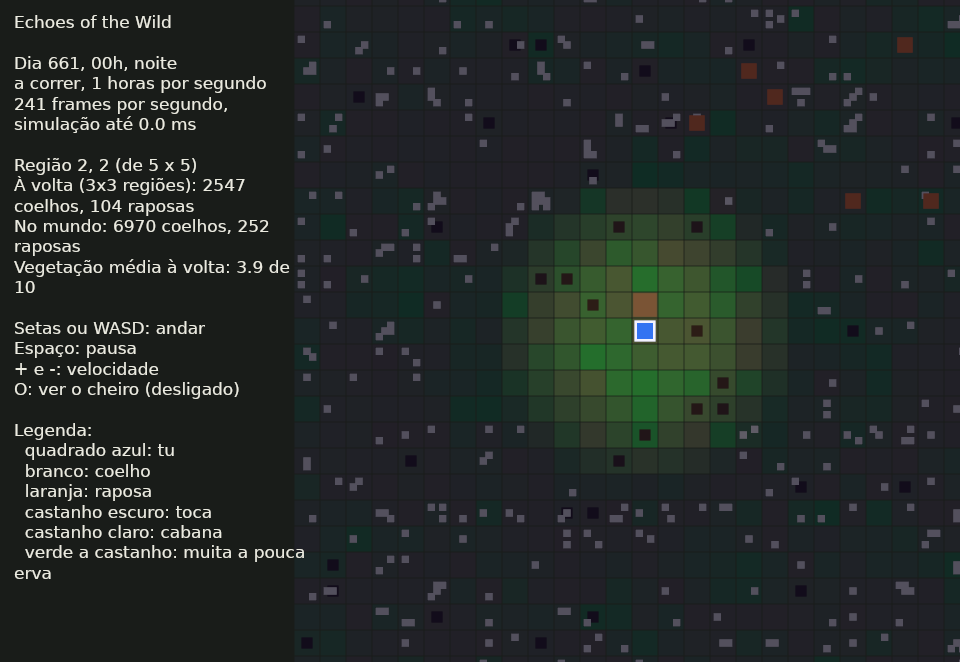
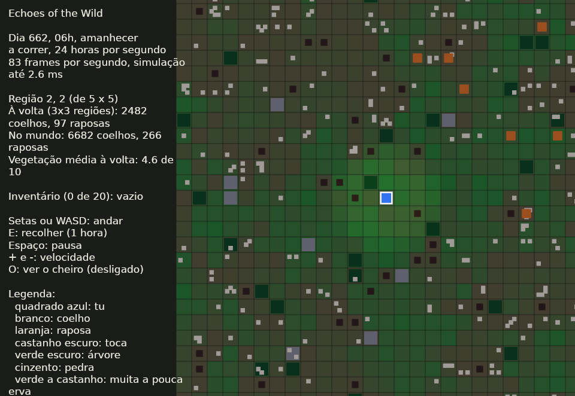

# Diário de Construção: Echoes of the Wild

Aqui registamos o que foi feito, quando, e que marcos foram alcançados, para celebrar cada passo.

**Como funciona:** cada entrada tem a data, o que foi feito, o marco (se houve) e o que se aprendeu.
As entradas mais recentes ficam no topo. Quando um marco acontece, passa a ✅ no painel e ganha uma celebração. 🎉

---

## Painel de marcos

| # | Marco | Estado | Data |
|---|---|---|---|
| 1 | Design congelado (GDD v0.6) | ✅ | 2026-11-01 |
| 2 | Workspace criado (`eotw_sim`, `eotw_cli`, `eotw_game`) | ✅ | 2026-11-01 |
| 3 | Primeira simulação a correr (coelhos e vegetação) | ✅ | 2026-11-01 |
| 4 | Primeiro equilíbrio estável (50 seeds, 300 dias, sem extinções) | ✅ | 2026-11-01 |
| 5 | Primeiro `cargo run` no teu computador | ✅ | 2026-11-02 |
| 6 | Primeiro teste escrito por ti | ✅ | 2026-11-02 |
| 7 | Primeiro predador (raposa) | ✅ | 2026-11-02 |
| 8 | Perceção por cheiro a funcionar | ✅ | 2026-11-02 |
| 9 | Teste da cabana em modo texto | ✅ | 2026-11-02 |
| 10 | Primeira janela com Bevy (etapa 4) | ✅ | 2026-11-02 |
| 11 | O jogador no mundo: os animais fogem dele e do rasto que deixa | ✅ | 2026-11-02 |
| 12 | Performance medida: o mapa de 192x192 cinco vezes mais rápido | ✅ | 2026-11-02 |
| 13 | Região agregada com o mesmo equilíbrio da simulação completa | ✅ | 2026-11-02 |
| 14 | Mundo com várias regiões e animais a passar entre elas | ✅ | 2026-11-02 |
| 15 | Primeira paisagem a andar: a câmara segue o jogador por 25 regiões | ✅ | 2026-11-02 |
| 16 | Etapa 5 completa: ecossistema mínimo, em equilíbrio desde o primeiro dia | ✅ | 2026-11-03 |
| 17 | Prototype 01 completo | ⬜ | |

Os marcos 5 a 10 e o 17 seguem o plano da secção 19 do GDD e podem mudar. Os marcos 11 a 16 foram acrescentados depois, para o trabalho que veio a seguir à primeira janela.

---

## 2026-11-11 (quarta-feira, a fechar o dia)

### O Prototype 01 está completo e validado ✅

**Porquê:** depois das espécies novas, faltava fechar o protótipo com os critérios do GDD (18.4, 18.5 e 18.6). Perguntaste se os lobos eram mesmo tão raros: são, à escala real (no ecrã vês ≈6% do mapa, e a alcateia atravessa-o numa hora). Escolheste ficar com a densidade média.

**O que mudou:**
- **Cores:** os veados passaram a amarelos e os lobos a vermelho vivo, para se verem bem.
- **`eotw_cli --validate`:** o teste de equilíbrio na paisagem do jogo, com as cinco espécies, em 20 seeds de 100 dias. Escreve uma tabela que fica guardada em `docs/Validacao_Prototype01.md`.
- **Travão de densidade nos herbívoros:** a validação mostrou javalis a chegar a 33 (o dobro do máximo medido na natureza), porque todas as fêmeas pariam ninhadas de 4 no mesmo dia, sem travão. Agora as crias descem até 0 quando a paisagem chega à capacidade de carga medida (veado 32/km², javali 11/km²). O máximo passou a 21, num pico curto depois dos partos, e a média ficou em 6.

**O que se mediu:**
- **Equilíbrio:** nenhuma espécie chegou a 0 em 20 seeds; coelhos ≈5900, raposas ≈250, veados ≈13, javalis ≈6; a erva nunca desceu de 4,5.
- **Cabana:** com comida, as raposas passam 4,9 vezes mais horas na zona; a cadeia coelho → raposa → caça aconteceu 103 vezes, em 11 de 20 seeds, sem ser escrita.
- **Desempenho, transição agregado/individual, guardar e carregar:** todos dentro dos critérios.
- **Duas notas:** a migração de segurança não é contada na paisagem inteira, e a cadeia com o lobo (lobo mata → carcaça → raposa) existe mas é rara à escala real.

**Falta:** as tuas respostas às cinco perguntas de 18.5 (se compreendes os animais, se parecem naturais, se há situações não escritas, se as consequências se veem, se o mundo é interessante sem combate).

**Testes:** passam 144 no `eotw_sim` e 17 no jogo. A saída da CLI ficou igual, byte a byte.

**Próximo passo:** o commit do Prototype 01. Depois, a pesquisa a fundo de cada animal, um de cada vez.

---

## 2026-11-11 (quarta-feira, muito tarde)

### Veados, javalis e lobos, à escala real 🦌🐗🐺

**Porquê:** eram as últimas espécies do Prototype 01. Pediste uma pesquisa curta primeiro.

**A pesquisa** (três investigadores em paralelo e um relatório: `reports/Veados javalis e lobos.md`, notas em `research_notes/Veados javalis e lobos/`). Foi mundial, mas com lacunas: Hokkaido, Yellowstone, Białowieża, Cárpatos, França, Itália, Índia, Negev, e uma revisão do javali com 129 estimativas em 5 continentes. Corrigiu três números das fichas antigas: o lobo dos Cárpatos mata 32% crias, 54% fêmeas e 14% machos (não 44/40/16); o território em Białowieża é 219 km²; e não há fonte para "o javali cresce mais de 100% por ano" (o máximo medido é 24%). Também apanhei um erro de contas do relatório: 18 anos são 648 dias de jogo, não 177.

**A escala decidiu tudo.** Com células de 10 m, a paisagem tem 1,44 km². Os veados e os javalis cabem à densidade real (uns 14 e 4), mas o lobo não: o território de uma alcateia são 90 a 240 paisagens. Como a pesquisa foi mundial, escolheste a **opção A, tudo à escala real**. Comprimir como a raposa (×100) teria feito os veados comerem várias vezes a erva toda.

**O que mudou:**
- **Veados e javalis** (`ungulates.rs`): um só modelo com dois conjuntos de números. Andam em grupos, entram e saem pelas bordas porque a área vital deles é maior do que a paisagem, e comem a erva (perto de ti a de cada célula, longe a média da região).
  - O veado anda de manhã cedo e ao fim do dia, e foge de ti a 15 células.
  - O javali anda de noite, vai aos arbustos com frutos e esvazia-os (compete contigo), fossa a terra fora da época, e foge a 9 células, ou a 10 se ouve o machado.
  - Os dois só atravessam o rio nos vaus. Nascem crias no mês certo e envelhecem no ano de 36 dias.
- **Lobo** (`wolves.rs`): uma alcateia de 4–5 lobos atravessa a paisagem de noite, umas 3–4 vezes por ano de jogo, e sai em 1–2 horas. Se encontra veados ou javalis, tenta caçar, com as preferências medidas. Se mata, fica a comer e deixa uma carcaça. Foge de ti a 18 células.
- **Carcaças:** só a raposa as come, e deixam cheiro de comida, por isso a raposa encontra-as sem código novo. Os coelhos não lhes tocam.
- **No ecrã:** veados amarelos, javalis quase pretos, lobos vermelho vivo (e maiores), carcaças vermelho-escuras. Começaram castanhos e cinzentos, mas confundiam-se com a erva seca e as pedras, e mudaste-os. O painel conta os veados e os javalis e diz onde anda a alcateia.
- O formato dos ficheiros guardados passou à versão 5.

**O que se tentou e mudou:**
- Primeiro dei ao lobo um êxito diferente para cada classe de presa. Mas as preferências já vêm das presas mortas, por isso a composição ficava torcida duas vezes (57% crias em vez de 32%). Agora o êxito é igual dentro de cada espécie, e o teste dá a composição dos Cárpatos.
- Os veados ficavam em 9 em vez de 14, porque saíam mais grupos do que entravam. Agora entra um grupo por dia enquanto houver menos do que à densidade real: ficaram em 12,8.

**Medido:**
- 12,8 veados e 4,9 javalis em média (60 dias).
- A alcateia entrou 46 vezes em 360 dias e não matou nenhuma presa cá dentro: é a escala real.
- Os javalis comem 22% dos frutos de setembro.
- Uma hora de simulação custa 0,54 ms, e a viragem do dia 0,93 ms. No jogo, a simulação fica em ≈1 ms por frame, com picos de 4–7 ms.

**Ficou por fazer:** fome dos herbívoros; o javali a comer láparos; pegadas, cheiro e uivos do lobo; a raposa a fugir do lobo; a caça ao javali a torná-lo noturno. E, quando o Prototype 01 estiver fechado, a pesquisa a fundo de cada animal, um de cada vez.

**Testes:** passam 144 no `eotw_sim` e 17 no jogo. Há 14 novos: 7 dos herbívoros, 4 do lobo e 3 na paisagem (densidade real, javalis a comer frutos, alcateia rara). A saída da CLI ficou igual, byte a byte.

**Próximo passo:** fechar o Prototype 01 com os critérios de validação (GDD 18.5).

---

## 2026-11-11 (quarta-feira, quase meia-noite)

### O trabalho do jogador faz barulho 🪓

**Porquê:** o Prototype 01 pede eventos de ruído (GDD 7.6). Até aqui só os coelhos ouviam os passos do jogador, a 3 células.

**O que mudou** (versão simplificada):
- **Cortar madeira e partir pedra ouvem-se a 10 células**, construir a 6 e fazer ferramentas a 3. Procurar comida e apanhar folhas ou frutos são silenciosos.
- **Enquanto dura o barulho**, os coelhos que o ouvem fogem para a toca e as raposas afastam-se, como se te vissem perto. Por baixo, o barulho só alarga, durante essas horas, o alcance a que os coelhos ouvem o jogador e a distância a que as raposas se afastam dele.
- **Medido** (10 seeds, 3 horas de machado): nas 10 células à volta ficam 497 coelhos fora da toca, contra 1059 com o jogador calado, e 1 raposa contra 13.
- Ficou de fora o ruído entre animais (o grito de um coelho apanhado, um animal a fugir), porque mexe no equilíbrio medido. Sem jogador a simulação fica igual.
- O formato dos ficheiros guardados passou à versão 4.

**Testes:** passam 130 no `eotw_sim` e 17 no jogo, com 1 novo: o barulho do jogador espanta os animais. A saída da CLI ficou igual, byte a byte.

**Próximo passo:** as espécies novas, a começar pelo veado.

---

## 2026-11-11 (quarta-feira, já tarde)

### Arbustos e frutos da época 🫐

**Porquê:** o Prototype 01 pede "árvores, arbustos, ervas e frutos". É uma versão simplificada, e a pesquisa fica para depois.

**O que mudou:**
- **Arbustos:** 12 por cada 24x24, verde-oliva no ecrã, a ficar roxos quando têm frutos.
- **Frutos só na época:** de julho a outubro cada arbusto ganha 1 fruto por dia, até 6. Fora dela perde 1 por dia, porque os frutos caem e apodrecem. Usa o calendário que já existia, por isso no clima do sul as épocas trocam.
- **E ao lado de um arbusto** apanha 3 frutos numa hora. Cada fruto dá 15 de saciedade, por isso na época apanhar frutos rende 45 por hora, contra 25 a procurar na erva. **C** come os frutos primeiro. Fora da época o painel explica que o arbusto só dá frutos de julho a outubro.
- Os animais ainda não comem frutos nem se escondem nos arbustos, para não mexer no equilíbrio medido. Isso fica para os veados, os javalis e a raposa.
- O formato dos ficheiros guardados passou à versão 3.

**Desempenho:** a mediana da simulação ficou igual (cerca de 1,2 ms por frame a 240 horas por segundo). Com o processador a 82 °C as medições variaram muito, e numa de quatro houve picos acima dos 8 ms do orçamento. Não vêm dos arbustos; é para medir outra vez com a máquina fria, e ver se os picos vêm da viragem do dia, quando todas as regiões longe avançam ao mesmo tempo.

**Testes:** passam 129 no `eotw_sim` e 17 no jogo. Há 2 novos: os arbustos só dão frutos na época; os frutos apanham-se na época e comem-se primeiro. O teste dos recursos por região passou a contar os arbustos. A saída da CLI ficou igual, byte a byte.

**Próximo passo:** os eventos de ruído.

---

## 2026-11-11 (quarta-feira, à noite, mais tarde)

### Um rio atravessa a paisagem 🏞️

**Porquê:** o Prototype 01 pede "uma pequena floresta com rio e clareira". As clareiras já existiam; faltava o rio. É uma versão simplificada, e a pesquisa a fundo fica para depois.

**O que mudou:**
- **Um rio de 2 células de largura** vai de norte a sul, a serpentear. A cada 12 células há um **vau**, uma passagem sem água. Começa a mais de 12 células de onde o jogador aparece.
- **A água não tem erva**, nem tocas, árvores ou pedras. As que estavam no caminho saíram.
- **Os animais não entram no rio:** só o atravessam nos vaus. O truque está num sítio só, `World::neighbors`, que deixou de dar células de água; por isso todos os passos dos coelhos e das raposas o respeitam. Nenhum animal aparece na água, nem quando uma região longe volta a ter animais um a um.
- **O jogador passa a vau** por todo o lado, mas não constrói nem procura comida na água.
- **No jogo** o rio é azul-esverdeado, diferente do azul do jogador e do cheiro.
- O formato dos ficheiros guardados passou à versão 2: um mundo guardado antes do rio dá um erro claro.

**Desempenho:** igual ao de antes. A 240 horas por segundo, a simulação gasta cerca de 1,1 ms por frame e no máximo 5,5 ms, dentro dos 8 ms do orçamento.

**Testes:** passam 127 no `eotw_sim` e 17 no jogo. Há 3 novos: o rio atravessa o mapa com vaus e sem buracos; sem rio ou num mapa pequeno não há água; o rio corta a paisagem sem animais nem erva, e fica igual quando a janela anda. O teste das árvores e pedras por região corre agora sem rio. A saída da CLI ficou igual, byte a byte.

**Próximo passo:** arbustos e frutos.

---

## 2026-11-11 (quarta-feira, ao fim do dia)

### O hardware-alvo e o orçamento de tempo ⏱️

**Porquê:** o GDD dizia "hardware-alvo ainda por definir". Fizemos a lista do que falta no Prototype 01 e começámos pelo mais curto.

**O que ficou definido** (no GDD, 18.6):
- **Hardware-alvo mínimo:** o teu portátil, com um i5-10210U, a gráfica Intel integrada e 7,5 GB de memória.
- **Orçamento:** 60 frames por segundo (16,7 ms por frame). A simulação pode gastar até 8 ms no pior frame, mesmo à velocidade máxima, e o percentil 95 do frame tem de ficar abaixo de 10 ms.

**Medido:** a 240 horas por segundo, o frame mediano é de 4,3 ms (230 fps), o p95 de 6,1 ms e o pior de 8,8 ms. A simulação gasta no máximo 3,2 ms. Cabe com folga. A partir de agora, cada espécie nova volta a passar por esta medição.

**Próximo passo:** o rio.

---

## 2026-11-11 (quarta-feira, mais tarde)

### O que o jogador muda no mundo fica 🌳

**Porquê:** o ponto seguinte da Etapa 7 era testar se as alterações ao ambiente ficam.

**O teste novo** (`as_alteracoes_do_jogador_ficam`) corta todas as árvores de uma região, come-lhe a erva toda e constrói o abrigo. Depois o jogador vai para longe, e a região passa a agregada. Lá longe passam 2 dias, o jogo guarda e carrega, e o jogador volta. Ao lado corre um mundo igual onde ninguém mexeu, para comparar.

**O que se viu:** tudo ficou, e não foi preciso corrigir nada.
- As árvores continuam cortadas e a crescer 0,1 por dia, com a clareira à volta.
- O abrigo está no mesmo sítio e volta a cheirar a gente.
- A erva da região fica com menos de metade: 2,2 contra 4,8 no mundo onde ninguém mexeu.

**Limite conhecido:** enquanto a região está agregada, guarda-se só a erva média, não a de cada célula, e o cheiro perde-se. O cheiro desce 1% por hora, por isso ao fim de uns dias já se teria quase ido.

**Testes:** passam 124 no `eotw_sim` e 17 no jogo.

**Próximo passo:** espécies novas do Prototype 01 (veados, javalis e lobos), começando pela pesquisa.

---

## 2026-11-11 (quarta-feira, à noite)

### Guardar e carregar o mundo 💾

**Porquê:** com a fome e a saúde, a Etapa 6 ficou fechada. A Etapa 7 começa por guardar e carregar mundos, que também é a "Persistência" do Prototype 01 (18.2).

**O que mudou:**
- **F5 guarda o mundo e F9 carrega-o**, em `saves/mundo.json` (a pasta não vai para o git).
- **Vai tudo para o ficheiro:** a configuração, as regiões longe do jogador, cada coelho e cada raposa à volta dele, a erva, o cheiro, as árvores, o abrigo, o inventário, a fome, a saúde, e até o estado dos números ao acaso. Por isso, depois de carregar, o mundo continua exatamente como teria continuado.
- **Um ficheiro de outra versão** dá um erro claro em vez de carregar mal.
- Para isto, o nome do clima e o custo do abrigo deixaram de ser textos fixos no código. A "nunca descansa" dos coelhos deixou de ser infinito (o JSON não guarda infinitos) e passou a ser o maior número possível; o resultado é igual.
- Num mundo de 8x8 regiões o ficheiro tem 774 KB, e guarda e carrega em 2–3 ms.

**Testes:** passam 123 no `eotw_sim` e 17 no jogo. Há 3 novos: guardar e carregar continua igual, mesmo depois de a janela andar; um ficheiro de outra versão dá erro; um ficheiro guardado no disco volta igual. A saída da CLI ficou igual, byte a byte.

**Próximo passo:** continuar a Etapa 7.

---

## 2026-11-11 (quarta-feira, à tarde)

### O jogador tem fome e saúde 🍄

**Porquê:** o passo seguinte do GDD era a sobrevivência do Prototype 01 ("Saúde e alimentação simples", 18.2). Pediste uma versão simplificada; a pesquisa a fundo fica para depois.

**O que mudou:**
- **Fome e saúde, de 0 a 100.** A fome desce 1,4 por hora: cheio, aguentas três dias. Sem comida perdes 2 de saúde por hora; bem alimentado recuperas 1 por hora.
- **F: procurar comida na erva** (ervas, raízes e cogumelos). Gasta 1 hora e 3 de vegetação, por isso tiras comida aos coelhos. **C: comer** uma porção (+25). Por dia chega cerca de uma hora e meia de procura.
- **Desmaiar:** com a saúde a 0 desmaias e acordas com 25 de saúde e de fome. Ainda não há morte.
- O painel mostra a fome e a saúde, e avisa quando desmaias.

**Testes:** passam 121 no `eotw_sim` e 16 no jogo, com 5 novos. A saída da CLI ficou igual, byte a byte.

**Próximo passo:** continuar o GDD pela ordem do plano.

---

## 2026-11-11 (quarta-feira)

### Revisão do código e correção de bugs 🐛

**Porquê:** pediste uma revisão do código à procura de bugs. Pediste também atenção ao desempenho, para quando houver mais espécies.

**O que mudou:**
- **A fome das raposas longe do jogador.** Nas regiões agregadas, as raposas só morriam de fome com menos de 5 coelhos por raposa, e sempre 5% por dia. Medi a simulação completa: os roedores não chegam para uma raposa viver só deles, e sem coelhos morre cerca de um quarto por dia. A regra fixa passou a ser uma tabela medida, por coelhos por raposa (`fox_hunger`). Com um décimo dos coelhos, ao fim de 30 dias, a agregada passou de 3,9 para 2,8 raposas (a completa tem 1,6). Um primeiro aviso da revisão dizia o contrário, que a agregada era dura demais; a medição mostrou que era branda.
- **As folhas.** Quando só cabia parte no inventário, gastava-se a erva toda e o painel mostrava a quantidade toda. Agora só se gasta a erva das folhas que couberam. Uma quantidade com casas decimais já não dá zero folhas.
- **O abrigo de ramos já não se encosta a um toco.** Tem de ser uma árvore que ainda abriga, como no resto do código.
- **A sombra das árvores** só se refaz quando uma árvore cortada volta a crescer o suficiente. Antes refazia-se a cada hora de jogo.

**Desempenho:** longe do jogador, os animais já não existem um a um. Cada região agregada guarda só quantos há de cada idade, e avança um dia de cada vez. Medi: uma região agregada custa 1,5 µs por dia de jogo, e uma completa 509 µs, ou seja 338 vezes mais. Por isso não vale a pena tirar os animais de todo; o que custa é a janela de 3x3 regiões à volta do jogador. Quando houver mais espécies, cada uma entra na agregada da mesma maneira, como números por idade.

**Testes:** passam 117 no `eotw_sim` e 15 no jogo. Há 3 testes novos: as raposas passam fome como na completa; o abrigo não se encosta a um toco; as folhas que não cabem não gastam erva. A saída da CLI (`--seed 7 --days 200`) ficou igual, byte a byte.

**Próximo passo:** continuar o GDD pela ordem do plano.

---

## 2026-11-09 (segunda-feira, à tarde)

### O jogador constrói o seu abrigo 🛖

**Porquê:** perguntaste em que parte do plano estávamos. Faltava a construção de abrigo para fechar a Etapa 6. Disseste que o jogador não devia começar com um abrigo pronto, nem com uma tenda, para haver um objetivo nos primeiros dias. Por omissão o jogo já começava sem cabana: a cabana atual é uma experiência do GDD 18.6, que só aparece com `--cabin`. Faltava um abrigo que o próprio jogador construísse.

**A pesquisa veio primeiro**, com a skill nova (notas em `research_notes/Abrigos construídos pelo jogador/`, relatório em `reports/Abrigos construídos pelo jogador.md`):
- **Abrigos de emergência:** o manual FM 21-76 pede 5–8 varas de cerca de 3 m para um abrigo de ramos, 1 m de folhas por cima para uma cabana de folhas e uma cama de 30 cm. Diz também que em repouso se perde até 80% do calor para o chão, mas é a única fonte que o diz.
- **Abrigos tradicionais:** chozos da Estremadura, Star Carr e Howick, as chise dos Ainu, as cabanas de folhas dos Baka e dos Mbuti, o wigwam dos Ojibwe e outros. Por todo o mundo, a passagem do provisório ao permanente faz-se no mesmo sítio e com a mesma planta, trocando de material. Os quatro tipos de chozo já são uma escada de melhorias.
- **Outros jogos:** cada melhoria tem de trazer algo novo. No UnReal World os jogadores acham que a cabana não compensa o esforço.

**Decidiste fazer só o abrigo, sem efeito no jogador por agora.** O jogador ainda não tem frio nem cansaço, por isso o abrigo não o protege de nada.

**O que mudou:**
- **Um item novo, as folhas.** Recolhem-se com E na erva, onde não há árvore nem pedra ao lado. Cada folha gasta 2 de vegetação, por isso tirar folhas tira comida aos coelhos.
- **A tecla B constrói ou melhora o abrigo**, em quatro etapas no mesmo sítio:

  | Etapa | Custo | Horas |
  |---|---|---|
  | Abrigo de ramos | 6 madeira, ao lado de uma árvore | 2 |
  | Cabana de folhas | 10 folhas | 3 |
  | Chozo com base de pedra | 8 pedra, 6 madeira | 6 |
  | Chozo com lareira | 6 pedra | 4 |

  A primeira etapa não se faz em cima de uma árvore, de uma pedra ou de uma toca. Só há um abrigo, e as melhorias fazem-se nele. Se faltar material, não gasta nada.
- **O abrigo cheira a gente:** deixa cheiro humano por hora, 1 / 1,5 / 2 / 6 por etapa (o jogador deixa 5). Com a lareira cheira mais do que o jogador, por causa do fumo. Só cheira quando está dentro da janela simulada.
- **No ecrã:** o abrigo aparece no mapa, cada vez maior, e com lareira fica avermelhado. O painel mostra o abrigo e o que falta para a etapa seguinte.

**Testes:** passam 114 no `eotw_sim` e 15 no jogo. Há 7 testes novos:
- o primeiro abrigo precisa de uma árvore e de madeira;
- as etapas constroem-se no mesmo sítio;
- o abrigo cheira a gente;
- recolher folhas gasta erva;
- as etapas seguem pela ordem certa;
- a lareira cheira mais do que o jogador;
- o painel explica a construção.

Dois testes mudaram de propósito:
- `sem_espaco_ou_sem_recurso_nao_gasta_tempo`: agora uma célula vazia dá folhas, por isso o teste desliga as folhas para continuar a testar o mesmo;
- `o_painel_explica_a_recolha`: a frase passou a falar também da erva.

O clippy está limpo. Sem abrigo, a simulação dá exatamente o mesmo resultado que antes (`eotw_cli --seed 7 --days 200`, byte a byte).

**O que ainda falta:**
- uma razão para o jogador se abrigar, como o descanso ou o frio;
- a chuva e o vento;
- guardar coisas no abrigo;
- a lareira assustar os animais de forma mais clara do que pelo cheiro.

Os custos e os tempos são decisões de jogo. Não encontrei tempos de construção medidos para cada tipo de abrigo.

**A seguir:** testares no jogo. Recolhe 6 de madeira, põe-te ao lado de uma árvore e carrega em B.

## 2026-11-09 (segunda-feira)

### O jogo passa a ter calendário 📅

**Porquê:** o relatório "Vida social mundial coelho e raposa" propõe 24 regras para dar vida social aos coelhos e às raposas, e quase todas dependem da altura do ano: quando se cria, quando os jovens saem de casa, quando os grupos se fecham. Escolheste começar pelas estações. Antes de escrever o código pesquisei o calendário dos dois animais em várias partes do mundo (notas em `research_notes/Calendário do coelho e da raposa/`). Foi a primeira vez que usei a skill nova de pesquisa global.

**Um ano de 36 dias.** Cada mês dura 3 dias de jogo. Este número não foi escolhido ao acaso, sai das idades que o jogo já tinha:
- o coelho amadurece aos 10 dias de jogo e o coelho-bravo do sul de Espanha cria pela primeira vez aos 3–4 meses;
- a raposa amadurece aos 30 dias e a raposa real acasala aos 10 meses (Newsome & Coman 1989).

As duas contas dão cerca de 3 dias por mês. A simulação começa em julho: com os 60 dias de aquecimento (20 meses), chegas em março, no pico das crias dos coelhos.

**O que o calendário sabe de cada mês:**
- a estação (no hemisfério sul fica trocada);
- se os coelhos criam. Na Ibéria criam de novembro a junho, com pico em março e abril, e param no verão seco (Gonçalves 2002 em Pancas; Delibes & Calderón e Soriguer no sudoeste);
- a fase da raposa: acasalamento em janeiro, gestação, crias na toca em março e abril, crias fora da toca em maio e junho, família no verão e dispersão de outubro a dezembro. Os partos de Doñana são do fim de fevereiro a março;
- a probabilidade de uma raposa jovem dispersar nesse mês. A tabela é a de Bristol (Smith & Harris 1991): zero de abril a setembro e pico em dezembro. Bate certo com Doñana, onde a dispersão vai de outubro a janeiro (Travaini et al. 1993).

Há quatro climas: mediterrânico ibérico (o padrão), temperado oceânico (Inglaterra e Países Baixos, onde os coelhos criam de fevereiro a setembro), temperado continental (Bayreuth e Suécia, de março a setembro) e temperado do sul (Nova Zelândia e Austrália, com tudo deslocado seis meses).

**No ecrã** aparece uma linha nova, por exemplo "1 de março, primavera, ano 2" e "Coelhos: pico das crias; raposas: crias na toca".

**O que não muda:** os animais ainda não usam o calendário. O resultado da simulação é exatamente igual ao de antes (`eotw_cli --seed 7 --days 200` deu a mesma saída, byte a byte). O calendário só prepara as regras que vêm a seguir.

**Testes:** passam os 108 do `eotw_sim`, 5 deles novos:
- o ano tem 36 dias e começa em julho;
- o jogador chega em março;
- as estações trocam no sul;
- na Ibéria os coelhos param no verão;
- a raposa só dispersa de outubro a março.

O clippy está limpo.

**Uma coisa que a pesquisa mostrou:** as probabilidades mensais de Bristol fazem sair cerca de metade dos machos jovens, mas a proporção medida em Bristol é 44 ± 26%. Estão dentro da margem, mas são duas medições diferentes, e o teste aceita de 45% a 55%.

**O que ainda falta:**
- o comprimento do dia ainda não muda com a estação;
- a reprodução dos coelhos e das raposas ainda não segue a época;
- não há anos secos nem húmidos (num ano seco os coelhos só criam de janeiro a março);
- não há números ibéricos de dispersão da raposa, por isso usa-se a tabela de Bristol;
- faltam fontes primárias do sul de França, da Irlanda, do centro de Espanha e do Chile.

**A seguir:** testares no jogo e ver se a data no ecrã faz sentido. Depois, pôr a reprodução a seguir a época.

## 2026-11-05 (quinta-feira)

### O coelho e a raposa com números da natureza 🐇🦊

**Porquê:** a terceira ronda de pesquisa ("Mecânicas quantitativas dos animais", em `reports/`) comparou o jogo com números medidos e encontrou três desvios que se compensavam uns aos outros:
- o coelho descansava de noite, mas o coelho bravo digere na lura de dia e come ao crepúsculo e de noite;
- a raposa acertava 50% das tentativas, contra cerca de 23% medidos sobre mamíferos;
- um coelho dava à raposa comida para 5 dias, contra 1 a 1,5 na natureza.

Corrigimos os três juntos e aceitaste que a população passasse a ter ciclos mais fortes.

**O coelho descansa ao meio-dia.** A regra é a mesma, mas passou da noite para o meio-dia (das 9h às 17h, `DaylightParams::midday`): um coelho com energia entre 40 e 60 vai para a toca e recupera lá. Ao meio-dia estão na toca 27% dos coelhos, contra 4% à meia-noite. Antes era ao contrário.

**Pôr quase todos na toca não deu.** Na natureza, ao meio-dia estão na toca cerca de 90%. Experimentei pôr na toca todos os coelhos com 30 ou mais de energia, sem teto: ao meio-dia ficavam lá 84%. Mas assim voltavam todos às tocas todos os dias, comiam só à volta delas, rapavam lá a erva, e de noite quase não ganhavam energia. Quase deixaram de ter crias e a população caiu para menos de 10. É a mesma armadilha do pastoreio junto às tocas que já tínhamos visto.

**O coelho ouve o jogador.** Com os coelhos ativos de noite, só viam o jogador a 2 células e o teste `o_jogador_afasta_os_animais` falhava. Uma pessoa a andar ouve-se, por isso o coelho ouve o jogador a 3 células, de dia e de noite (`player_hearing`). A raposa anda calada e continua a só se ver. Na natureza, a lebre foge de uma pessoa a cerca de 70 m (7 células).

**A raposa ficou com os números medidos:**
- acerta 25% das tentativas (`catch_chance`, antes 0,5);
- gasta 2,4 por hora ativa e 0,4 a descansar ou a comer restos parada (antes 0,35 sempre). Um coelho (45 de energia) chega-lhe para cerca de um dia e meio;
- de dia só caça abaixo de 20 de energia (antes 50), e de noite abaixo de 70 (antes 60);
- apanha roedores: com fome, tenta um salto na erva onde está. Acerta 45% na erva baixa e cerca de um terço disso na erva alta, e cada roedor dá 4. Os roedores não são animais da simulação. Dão à raposa a dieta mista que ela tem na natureza.

**Cada mudança da raposa partiu outra coisa:**

| Tentativa | O que aconteceu |
|---|---|
| Só 12 de energia por coelho | As raposas nunca chegavam aos 75 para ter crias: ficavam em 2 por região |
| Gasto de 1,4 sempre | Equilíbrio bom, mas 47% das caçadas eram de dia |
| Caçar de dia só abaixo de 20, sem gasto menor a descansar | As raposas passavam o dia com fome e ficavam em 1,4 a 2,4 |
| Gasto menor a descansar | Funcionou, mas comer restos na cabana passou a custar mais do que dava, e os testes da cabana falharam |
| Comer restos parada gasta como descansar | Os restos voltaram ao valor antigo (0,5) e a cabana voltou a funcionar |
| `hunt_below` 60 ou 65 | Com uma raposa só no início, às vezes morria e era precisa migração (`margens_de_equilibrio`) |

**O resultado** (10 seeds, 900 dias, mapas de 24x24):

| | Antes | Agora |
|---|---|---|
| Coelhos | 276 | 229 |
| Raposas | 8,0 | 10,5 |
| Coelhos caçados por raposa por dia | 0,2 | 0,3 |
| Oscilação dos coelhos | 7,9% | 20% |
| Caçadas de dia | menos de 5% | 2% |
| Na toca à meia-noite / ao meio-dia | 26% / 5% | 4% / 27% |

A oscilação é a que aceitaste: com a raposa a comer mais coelhos por dia, coelhos e raposas sobem e descem em ciclos, como na natureza. Nenhuma seed se extinguiu.

**A agregada.** A raposa come agora 0,30 coelhos por dia na completa (antes 0,205), e foi esse o valor que entrou em `prey_per_fox`. As distribuições da conversão para animais (energia de coelhos e raposas, raposas saciadas e à espera, coelhos na toca à meia-noite) foram medidas outra vez da mesma maneira (10 seeds, 5 momentos). As tabelas das crias, da reserva e da fome não mudaram: com elas a agregada já fica dentro dos limites.

| | Completa | Agregada |
|---|---|---|
| Coelhos (24x24, dias 500 a 900) | 235 | 246 (+4,4%) |
| Raposas | 10,2 | 10,0 (−2%) |
| Vegetação | 5,29 | 5,10 (−3,5%) |
| Coelhos por região, 48x48 | 940 | 979 (+4,1%) |

**Nenhum limite de teste foi alargado.** O choque de 15% e a cabana de 1,5 ficaram como estavam. Dois testes mudaram de propósito:
- `de_noite_ha_mais_coelhos_na_toca` passou a `ao_meio_dia_ha_mais_coelhos_na_toca`, com a comparação ao contrário;
- `a_paisagem_fica_em_equilibrio` tinha um intervalo à volta do equilíbrio antigo (240 a 330 coelhos e 3 a 12 raposas por região). O equilíbrio desceu de propósito, por isso o intervalo desceu com ele (190 a 280 e 6 a 15), com a mesma largura. A janela dava 239 coelhos e 11,2 raposas, e as agregadas 241 e 10,2.

**Testes novos:**
- `com_fome_apanha_roedores_mais_na_erva_baixa`;
- `de_noite_ouve_o_jogador_mas_nao_a_raposa`;
- `o_meio_dia_vai_das_9_as_17`.

**Ainda não feito:**
- a curva do coelho hora a hora do relatório (9 h à superfície, dois picos ao crepúsculo e uma noite moderada). O coelho continua ativo toda a noite;
- o cheiro que dura menos com calor e o vento;
- a gazapera e as doenças do coelho.

**O que se aprendeu:** os três desvios estavam mesmo a compensar-se. Corrigir um só desequilibrava tudo, e cada correção da raposa mostrou um pressuposto escondido: que descansar custa o mesmo que caçar, ou que comer restos é uma atividade.

**Próximo passo:** testares no jogo.

## 2026-11-03 (terça-feira)

**O que foi feito**

- O painel de marcos estava parado no marco 10, apesar de o jogador, a performance e a paisagem terem entradas próprias. Ganharam marcos: do 11 ao 15. O "Prototype 01 completo" passou a ser o 16.

**Marcos** 🎉

- Marco 11: **o jogador no mundo**. Os coelhos e as raposas fogem dele, e as raposas evitam o rasto que ele deixa. 🧍
- Marco 12: **performance medida**. O mapa de 192x192 passou de 15 ms para 3 ms por tick, com resultados iguais byte a byte. ⏱️
- Marco 13: **região agregada**. Reproduz o equilíbrio da completa (281 coelhos contra 276) e recupera de choques à mesma velocidade. 📊
- Marco 14: **mundo com várias regiões**. Os animais passam de região em região, e uma região vazia volta a encher-se. 🗺️
- Marco 15: **primeira paisagem a andar**. A câmara segue o jogador por 25 regiões, e o que ele vê é sempre simulado animal a animal. 🎥

**Próximo passo:** correr `cargo run --release -p eotw_game`, atravessar fronteiras de região e ver se há soluços, animais a aparecer ou a desaparecer à vista, e como corre a 240 horas por segundo.

### O lag da paisagem 🐢→🐇

**O que viste:** lag no jogo em release, mesmo em pausa e parado. Por isso a causa não era a simulação.

**Como se encontrou a causa.**
- **Uma opção para medir:** o jogo ganhou a opção `--frames N`. Corre N frames sem esperar pelo ecrã, escreve a mediana e o pior tempo por frame, e sai.
- **Desligar um sistema de cada vez:** desliguei cada sistema de desenho à vez, e apareceram duas causas.

**Causa 1: os animais eram apagados e criados em cada frame.**
- **O que acontecia:** em cada frame, o jogo apagava e voltava a criar uma entidade do Bevy por cada coelho, raposa e toca à vista. Com centenas de coelhos, isso levava a maior parte do frame: 22 ms de mediana, contra 5 ms sem desenhar os animais.
- **Correção:** os sprites passaram a ser sempre os mesmos. Em cada frame mudam de sítio, cor e tamanho, e os que sobram escondem-se, como já se fazia com os quadrados do chão.
- **Mexer só no que mudou:** os quadrados e o texto do painel também só se alteram quando mudam, porque cada alteração obriga o Bevy a voltar a enviar tudo para a placa gráfica.
- **Teste:** `os_sprites_dos_animais_reaproveitam_se`.

**Causa 2: a placa NVIDIA tinha soluços próprios.**
- **O que acontecia:** a MX250, com o controlador NVK, tinha um soluço de cerca de 33 ms a cada 20 frames, mesmo sem nada para desenhar.
- **Correção:** a placa Intel integrada não tem esses soluços, e para um jogo 2D chega bem. O jogo passou a escolhê-la por omissão. Com `WGPU_POWER_PREF=high` usa-se a NVIDIA.

**Resultado** (release, 240 horas por segundo, 1800 frames):

| | Frame mediana | 95% dos frames abaixo de | Pior frame |
|---|---|---|---|
| antes (NVIDIA, sprites novos em cada frame) | 17 a 22 ms | 32 ms | 43 ms |
| sprites reaproveitados, NVIDIA | 7,2 ms | 32 ms | 34 ms |
| sprites reaproveitados, Intel (por omissão) | 3,9 ms | 5,2 ms | 7,9 ms |

**Também mudou no jogo:**
- **O painel mostra a performance:** os frames por segundo e o pior tempo da simulação, renovados duas vezes por segundo.
- **`--speed N`:** começa a N horas de jogo por segundo.
- **Capturas de ecrã:** passaram a esperar 2 segundos em vez de 30 frames. Em release, 30 frames passavam antes de a letra carregar.


**O que se aprendeu**

1. **Medir antes de adivinhar.** Pela medição feita sem janela, a simulação gastava 1,4 ms por frame, por isso o lag tinha de estar no desenho. Mas só desligar cada parte mostrou que eram duas causas, e que uma delas nem era do nosso código.
2. **Criar e apagar entidades é caro no Bevy.** Mudar uma entidade que já existe é muito mais barato.

**Teste em jogo:** a jogar normalmente, com vsync, a Intel deu 176 a 180 frames por segundo, sem lag. A NVIDIA ficou nos 20 frames por segundo, muito pior do que nas medições sem vsync. Fica confirmado que a Intel é a escolha certa por omissão. A NVIDIA só volta a ser opção se o controlador NVK melhorar.

### Histerese nas fronteiras ↔️

**O problema:** a janela deslocava-se logo que o jogador mudava de região. Quem andasse para trás e para a frente em cima de uma fronteira fazia a janela andar a cada passo. Em cada deslocamento, as regiões que saem são agregadas e as que entram são expandidas: custa cerca de 0,6 ms e baralha os animais dessas regiões sem necessidade.

**A solução:** a janela guarda a região do meio (`centre`) e só se desloca quando o jogador já entrou mais de 4 células (`HYSTERESIS`) numa região vizinha. Para voltar atrás, vale o mesmo. Em troca, o jogador pode ficar 4 células mais perto da margem da janela: a margem fica agora a 20 células ou mais dele (`WINDOW_MARGIN`), em vez de 24. Continua a ser mais do que as 8 de `SPAWN_CLEAR_RADIUS` e do que meia vista do jogo (15 células), o que é verificado ao compilar.

**Medição** (2000 passos ao acaso, numa paisagem de 5x5 regiões):

| | Deslocamentos antes | Deslocamentos agora |
|---|---|---|
| passeio ao acaso | 42 | 7 |
| para trás e para a frente, a começar em cima de uma fronteira | 105 | 13 |

**Testes novos:**
- `andar_em_cima_da_fronteira_nao_desloca_a_janela`: 4 passos para lá e 4 para cá, 10 vezes, e a janela não se mexe; com o quinto passo desloca-se, e não volta para trás ao regressar à fronteira.
- `o_jogador_fica_longe_da_margem_da_janela`: em 3000 passos ao acaso, o jogador nunca fica a menos de 20 células da margem da janela (a não ser nas margens da paisagem).

### Mais raposas na janela 🦊

**O que se via:** a janela tinha 8,5 raposas por região e as agregadas 6,5. Pensei que vinha do tamanho do mapa, porque um mapa de 48x48 também dava 8,5.

**O que era:** as medições paravam cedo demais. As raposas vivem 400 dias, e as medições, e a tabela das crias de raposa, iam só até ao dia 300 depois do aquecimento. Nessa altura ainda nenhuma raposa tinha morrido de velhice e a população ainda estava a subir. Medindo até ao dia 1200:

| Por região, dias 500 a 1200 | Raposas |
|---|---|
| um mapa de 24x24 isolado | 11,4 |
| um mapa de 72x72 | 10,4 |
| na janela da paisagem | 11,3 |
| nas agregadas da paisagem | 7,9 |

Só as agregadas estavam erradas, porque a tabela delas tinha sido medida antes do equilíbrio.

**Porque a tabela antiga não servia:** com o mesmo número de raposas, há mais crias em equilíbrio do que no início. Com 7 raposas por região, há 0,0053 crias por raposa por dia em equilíbrio, contra 0,0026 no início. No início, as raposas descendem todas das mesmas duas e estão juntas: cada uma tem rivais no seu território, e com rivais por perto há menos crias. Em equilíbrio já estão espalhadas.

**A correção:** a tabela `fox_births` foi medida de novo em cada região de 24x24 de 8 mapas de 72x72, entre os dias 500 e 1500. As crias de cada dia contam-se na região onde nascem.

| Por região, dias 500 a 1200 | Antes | Agora |
|---|---|---|
| na janela | 11,3 | 11,5 |
| nas agregadas | 7,9 | 10,5 |

**Testes:** `a_agregada_tem_o_mesmo_equilibrio_que_a_completa` e `uma_regiao_maior_tem_o_mesmo_equilibrio` passaram a comparar os dias 500 a 900, em vez de 40 a 300. Num mapa de 24x24, a completa fica com 10,9 raposas e a agregada com 10,8. Num de 48x48, com 37,6 e 43,9 (17% a mais, dentro da tolerância de 25%).

**O que se aprendeu**

1. **Medir até ao equilíbrio de todos.** Os coelhos chegam ao equilíbrio em semanas, mas as raposas só depois da primeira geração morrer de velhice. Uma medição que acaba antes disso compara o arranque e não o equilíbrio.
2. **A densidade não diz tudo.** As crias de raposa dependem também de como as raposas estão espalhadas, e isso muda muito entre o início e o equilíbrio.

**O que ainda falta**

- **O jogo começa longe do equilíbrio das raposas:** cerca de 4 por região, e só chegam às 10 ou 11 ao fim de cerca de 600 dias de jogo (10 minutos a 24 horas por segundo). Um aquecimento mais longo, ou mais raposas ao começar, resolve isto.

**Próximo passo:** os pontos que ainda estão em aberto: o arranque longe do equilíbrio das raposas, as falhas no rasto a velocidade baixa e o determinismo de `exp` entre plataformas.

---

### O arranque em equilíbrio e o fim da etapa 5 🏁

**O problema:** o jogo começava com cerca de 4 raposas por região, e elas só chegavam às 10 ou 11 ao fim de uns 600 dias de jogo.

**A solução:** antes de o jogador chegar, a paisagem corre 600 dias (`WARMUP_DAYS`) só com regiões agregadas, com animais a passar entre elas. Só depois se expande a janela. Agregadas, as 25 regiões correm esses 600 dias em cerca de 100 ms: criar a paisagem do jogo passou de 530 para 630 ms. O jogo começa agora no dia 660 do mundo.

**Resultado** (paisagem do jogo, 5x5 regiões, 4 seeds):

| Raposas por região | No dia em que o jogador chega | 250 dias depois | 500 dias depois |
|---|---|---|---|
| na janela | 10,7 | 11,1 | 11,4 |
| nas agregadas | 10,3 | 10,2 | 10,1 |

Os coelhos ficam entre 267 e 277 por região durante esse tempo.

**Teste novo:** `a_paisagem_comeca_em_equilibrio`: logo ao criar a paisagem, a janela e as agregadas têm entre 8 e 14 raposas por região.

**Marco 16** 🎉: **etapa 5 completa**. O ecossistema mínimo do GDD está feito: presas e predadores, comida que acaba e volta a crescer, populações que reagem a ela, vários níveis de detalhe e a performance medida. E agora está em equilíbrio desde o primeiro dia em que o jogador chega.

**O que ficou em aberto, mas não é da etapa 5:** as falhas no rasto a velocidade baixa e o determinismo de `exp` entre plataformas.

**Próximo passo:** etapa 6 (sobrevivência e construção), a começar pelo dia e noite.

### O dia e a noite 🌙

Primeiro passo da etapa 6.

**A luz:** vai de 1 (dia) a 0 (noite). O amanhecer é das 5h às 7h e o anoitecer das 19h às 21h, e entre essas horas a luz sobe e desce aos poucos (`daylight.rs`).

**O que muda nos animais:**
- **Visão de noite (GDD 7.6):** o coelho passa a ver 2 células em vez de 3, e a raposa 4 em vez de 5. O olfato não muda.
- **A raposa caça de noite (GDD 9.2):** de dia descansa e só caça abaixo de 50 de energia (`day_hunt_below`), em vez de 60.

**A primeira tentativa não chegou:** só com a visão reduzida à noite, as caçadas ficavam iguais em todas as horas, cerca de 4,2% em cada uma. A raposa só caça um coelho que esteja a 1 célula dela, por isso ver 1 célula a mais ou a menos quase não conta. Para haver um ritmo de dia e noite, a raposa tinha de mudar de comportamento.

**Caçadas por hora** (20 seeds, dias 500 a 900, mapas de 24x24):

| | 7h às 20h | 21h | 22h | 23h | 0h às 6h |
|---|---|---|---|---|---|
| sem noite | 4% em cada hora | 4% | 4% | 4% | 4% em cada hora |
| com noite | 1% no total | 34% | 23% | 15% | 27% no total |

Às 21h, quando escurece, as raposas com fome saem todas ao mesmo tempo. O equilíbrio quase não muda: 269 coelhos e 10,9 raposas, contra 269 e 10,7 sem noite. Experimentei os limiares 30, 40 e 50 e dão todos o mesmo equilíbrio. Com 50 ainda há uma ou outra caçada à tarde. As tabelas das regiões agregadas são por dia, por isso continuam a servir.

**No jogo:**
- **A noite é azul-escura:** longe do jogador, as cores ficam com 35% do brilho, mas nunca pretas (GDD 15.3). À volta dele, até 6 células, vê-se quase como de dia.
- **O painel diz a parte do dia:** "dia", "amanhecer", "anoitecer" ou "noite".
- **O jogador chega às 7h da manhã.** Com `--hour 22` chega de noite.
- **Desempenho:** a 240 horas por segundo, o frame passou de 3,9 para 4,8 ms (209 frames por segundo), porque as cores dos quadrados mudam a cada hora de amanhecer e de anoitecer.



**Dois testes mudaram:**
- **`mapa_demasiado_pequeno_colapsa`:** com a noite, o mapa de 12x12 deixou de colapsar em 240 dias. Continua a colapsar, mas precisa de mais tempo, por isso o teste passou a correr 600 dias. Um mapa de 16x16 aguentou 600 dias com 40 seeds: talvez um dia o tamanho mínimo de região possa descer.
- **`comida_junto_a_cabana_atrai_animais`:** na seed 6, com 10 restos por dia, uma raposa descobriu a cabana e ficou lá a caçar de noite, e os coelhos passaram a ir lá menos do que sem comida. É a cadeia de acontecimentos que o GDD procura (18.4), e com 50 restos já acontecia antes. Agora o teste exige que os coelhos subam no total, e em cada seed onde nenhuma raposa foi à cabana.

**Testes novos:** `a_luz_sobe_de_manha_e_desce_a_tarde`, `de_noite_ve_se_menos`, `as_raposas_cacam_de_noite` (menos de 5% das caçadas de dia) e, no jogo, `a_noite_escurece_longe_do_jogador`.

**O que se aprendeu:** uma regra que parece certa pode não mudar nada. A visão reduzida à noite está no GDD e faz sentido, mas só a medição das caçadas por hora mostrou que não chegava.

**Próximo passo:** os coelhos, que de dia passam o tempo como de noite, e a seguir o resto da etapa 6 (inventário, recolha, ferramentas, crafting e abrigo).

### Os coelhos descansam de noite 🐇

**A regra final:** de noite, um coelho com energia entre 40 (`night_rest_above`) e 60 (`rest_cap`) vai para uma toca a até 6 células e descansa lá. Na toca não gasta energia e recupera 1,5 por hora. Os coelhos com menos de 40 continuam ativos, como de dia: gastam energia e só a recuperam a comer. Os que chegam aos 60 saem da toca e vão comer, porque para ter uma cria (aos 80) têm de comer. De dia ninguém descansa.

**O resultado** (20 seeds, dias 500 a 900, mapas de 24x24):

| | Antes | Agora |
|---|---|---|
| Coelhos | 269 | 264 |
| Raposas | 10,9 | 10,4 |
| Mortos à fome | 2 410 | 1 490 |
| Na toca à meia-noite | 7% | 24% |
| Na toca ao meio-dia | 9% | 10% |
| Desesperados (energia de 30 ou menos) | 30% | 26% |
| Variação dos coelhos em cada seed | 3,9% | 8,8% |

As caçadas por hora não mudaram. A variação é o desvio-padrão do número de coelhos a dividir pela média, em cada seed.

**Como lá chegámos.** Antes de chegar à regra final, testei cinco formas que não ficaram:

| Forma | Coelhos | Raposas | O que correu mal |
|---|---|---|---|
| De noite, acima de 50, recolhe-se na toca sem recuperar | 5 | 1,0 | colapso (1 564 migrações) |
| De noite pasta a até 2 células de uma toca | 263 | 8,8 | 16 990 mortos à fome, e só baixou a distância às tocas de 2,7 para 2,5 |
| Acima de 40 descansa e recupera 0 por hora | 5 | 1,5 | colapso (949 migrações) |
| Acima de 40 descansa e recupera 1,5 por hora, sem teto | 283 | 10,5 | ver abaixo |
| Descansa e recupera só até 50 a 70, e fica na toca | 6 a 13 | | colapso |

A forma sem teto parecia boa, mas criava três problemas:

- **A energia deixava de vir só da comida.** Descansar dava energia que chegava para ter crias, e a seguir a um choque a população disparava (376 coelhos em vez de 314).
- **Os coelhos oscilavam mais.** A variação subia para 9,8%, e havia seeds a cair para 118 coelhos.
- **Os coelhos ficavam mais esfomeados.** Os desesperados passavam de 30% para 43%. Um coelho desesperado ignora as ameaças, por isso o jogador passava a afastar só metade dos animais: 39 à vista com ele contra 58 sem ele (antes, 39 contra 97). O teste `o_jogador_afasta_os_animais` falhava por isso, e não por ruído da seed 8.

O teto dos 60 resolveu as crias e os desesperados, porque um coelho tem de comer para passar dos 60 aos 80. Mas a oscilação ficou maior do que antes. Vem de esconder os coelhos à hora em que as raposas caçam: o sistema predador-presa fica mais solto. **Há seeds que descem até 146 a 180 coelhos durante semanas.** Para o jogo, isto quer dizer períodos de escassez que antes não havia. Fica registado como uma consequência que aceitámos de propósito.

**A região agregada ganhou um estado novo: a reserva.**

- **A vegetação deixou de prever as crias.** Com o descanso, a seguir a um choque havia o triplo das crias com a mesma vegetação. A erva por coelho e a energia média também não serviam: a energia média só subia de 44 para 49.
- **O que as prevê é a reserva:** a fração dos coelhos com 60 ou mais de energia, que já não descansam e estão a caminho de ter uma cria.
- **Os valores medidos:** a reserva é de 11 a 14% em equilíbrio. A seguir a um choque sobe para 28% em 4 dias, e as crias por adulto passam de 0,013 para 0,08.
- **Na agregada:** a reserva caminha 30% por dia para um valor que depende da erva por coelho (`reserve_target`), e as crias dependem da reserva (`births`).
- **Na conversão:** ao converter para animais individuais, a energia é sorteada de cima ou de baixo dos 60 para respeitar a reserva.

Também voltei a medir as outras tabelas do coelho:
- a fome;
- a energia;
- os coelhos na toca, que passam a ser 24%, porque a conversão é à meia-noite;
- o `grazing`, que passa a 3,3.

Para medir apenas o equilíbrio, aproveitei só os dias de equilíbrio. Para medir os choques, cortei a meio os coelhos a cada 150 dias.

| | Completa | Agregada |
|---|---|---|
| Coelhos (dias 500 a 900) | 264 | 264 |
| Raposas | 10,3 | 11,0 |
| Vegetação | 4,78 | 4,69 |
| 21 dias depois de perder metade dos coelhos | 314 | 285 |

**No jogo:**
- **Os coelhos na toca deixaram de se desenhar** (`visible_rabbits`). Antes desenhavam-se por cima da toca, por isso, ao testar, não se viam coelhos a desaparecer de noite, apesar de o contador baixar.
- **A noite tem dois picos de movimento:** às 21h, quando escurece, 34% dos coelhos mudam de célula (a correr para as tocas, ou a fugir das raposas que saem), e às 6h 23% (a sair das tocas). De dia são 12%, e a meio da noite 9 a 13%. Por isso a noite parece mais ativa.
- **O contador baixa de noite** porque quase todas as caçadas são às 21h, 22h e 23h, e as crias nascem espalhadas pelo dia.

**Nenhum limite de teste mudou.** Passam os 15% do choque, os 1,5 da cabana e o teste do jogador (26 animais à vista com ele contra 53 sem ele).

**Testes novos:**
- no coelho: `de_noite_descansa_na_toca_e_recupera`, `de_noite_vai_para_a_toca_descansar`, `de_noite_com_pouca_energia_continua_a_comer`, `de_noite_acima_do_teto_vai_comer` e `de_dia_nao_descansa`;
- na simulação: `de_noite_ha_mais_coelhos_na_toca`.

**O que se aprendeu:**
1. **Medir a folga antes do comportamento.** O coelho vive à justa, e nenhum chega aos 90 de `full_energy`. Qualquer hora sem comer custa-lhe crias.
2. **Energia de graça desliga a população da comida.** Ela dispara e depois morre à fome.
3. **Uma média pode esconder o que interessa.** As crias vêm da cauda de cima da energia (a reserva), não da energia média.
4. **Um teste que falha "por uma seed" merece ser seguido.** O do jogador mostrava um problema real: metade dos coelhos tinha deixado de fugir.

**Próximo passo:** o resto da etapa 6 (inventário, recolha, ferramentas, crafting e abrigo).

### Árvores, pedras e inventário 🪓

Segundo passo da etapa 6: o jogador já pode recolher madeira e pedra (GDD 12, Fase 1).

**O que foi decidido antes de começar:**
- **Recursos:** só árvores e pedras, como pede o GDD. Os frutos ficam para mais tarde.
- **Ecologia:** cortar ainda não mexe no ecossistema. As árvores esgotam-se e voltam a crescer devagar, mas não mudam a erva nem o abrigo dos coelhos. A ligação do GDD 7.7 ("desflorestar reduz o abrigo e a capacidade") fica para quando houver machado.
- **Tempo:** cada recolha gasta uma hora de jogo. O mundo continua enquanto o jogador trabalha, e a noite passa a ser algo que se planeia.

**O que foi feito:**
- **Recursos no terreno** (`resources.rs`): cada região de 24x24 tem 20 árvores (4 madeiras cada, que voltam a crescer meia madeira por dia) e 8 pedras (6 pedras cada, que não voltam). Ficam fora das tocas, no máximo um por célula, e um mapa maior tem mais.
- **Números à parte:** os recursos são sorteados com uma sequência própria (`Rng::derived`). Por isso os testes de equilíbrio dão exatamente os mesmos números que antes: o resto do mundo de cada seed não mudou.
- **Como terreno, passam por todo o lado:** estão na simulação completa, a janela recorta-os e junta-os como às tocas, e a região agregada guarda-os e faz crescer as árvores uma vez por dia.
- **Inventário:** leva até 20 coisas, de todos os tipos juntos.
- **Recolher** (`Landscape::gather`): da árvore ou da pedra onde o jogador está ou numa das 4 células ao lado, 1 unidade por hora. Se não houver nada, se o recurso estiver gasto ou se o inventário estiver cheio, não gasta tempo, e o painel diz porquê.
- **No jogo:** tecla E para recolher. As árvores são quadrados verde-escuros e as pedras cinzentos, que encolhem à medida que se recolhem. O painel mostra o inventário e o resultado da última recolha. O tempo por frame não mudou (7,6 ms de mediana a 240 horas por segundo).



**Testes novos:**
- nos recursos: `o_inventario_tem_limite`, `as_arvores_voltam_a_crescer_e_as_pedras_nao` e `os_recursos_espalham_se_uma_por_celula`;
- na paisagem: `as_arvores_e_as_pedras_ficam_quando_a_janela_anda`, `recolher_madeira_gasta_uma_hora`, `sem_espaco_ou_sem_recurso_nao_gasta_tempo` e `as_arvores_crescem_nas_regioes_agregadas`;
- no jogo: `a_tecla_e_recolhe` e `o_painel_explica_a_recolha`.

**Testado no jogo:** a recolha de madeira e de pedra com o E funciona. Fica para rever o tamanho do inventário (20 coisas): só se vai saber quanto deve levar quando houver receitas que gastem madeira e pedra. (Mais tarde, as árvores passaram a crescer 0,1 de madeira por dia, em vez de 0,5: ver "As árvores são abrigo".)

**Próximo passo:** as ferramentas e o fabrico (crafting). Por exemplo, um machado de madeira e pedra que recolhe mais depressa.

### Machado e picareta 🪓⛏️

Terceiro passo da etapa 6: as primeiras ferramentas e o primeiro fabrico (GDD 12, Fase 1: "Criar ferramentas básicas").

**O que foi decidido antes de começar:**
- **Ferramentas:** um machado para a madeira e uma picareta para a pedra.
- **Efeito:** com a ferramenta certa recolhe-se o dobro, 2 unidades por hora em vez de 1 (GDD 10.5: as ferramentas reduzem o esforço).
- **Desgaste:** cada ferramenta aguenta 30 recolhas e parte-se. Assim, a madeira e a pedra continuam a ter uso depois de feita a primeira.
- **Onde:** fabrica-se em qualquer sítio, e cada fabrico gasta 1 hora. A oficina (GDD 10.2) fica para quando houver construção.

**O que foi feito:**
- **Receitas:** o machado leva 3 madeiras e 2 pedras, e a picareta 2 madeiras e 3 pedras. Leva-se uma de cada no máximo, e não ocupam lugar no inventário.
- **Fabricar** (`Landscape::craft`): gasta os materiais e 1 hora. Se faltar alguma coisa, diz quanto falta e não gasta nada.
- **Recolher com ferramenta:** dá 2 unidades, ou menos se o recurso ou o espaço no inventário não chegarem. Cada recolha gasta um uso, e a recolha que parte a ferramenta di-lo.
- **No jogo:**
  - **Teclas:** 1 faz o machado e 2 a picareta.
  - **Painel:** mostra as ferramentas com os usos que restam, e frases como "Para um machado falta 1 de pedra." ou "Recolheste 2 de madeira. O machado partiu-se."
  - **Letra:** o painel passou de 17 para 15, porque com as linhas novas a legenda deixava de caber.

**Testes novos:**
- no inventário: `fazer_um_machado_gasta_madeira_e_pedra` e `a_ferramenta_parte_se_ao_fim_dos_usos`;
- na paisagem: `com_machado_recolhe_o_dobro` (recolhe os materiais, faz o machado e corta 2 madeiras de uma vez) e `o_machado_parte_se`;
- no jogo: `a_tecla_e_recolhe` (agora também a tecla 1 sem materiais) e `o_painel_explica_a_recolha`.

### As árvores são abrigo 🌳

**Porquê agora:** ao testar as ferramentas, achaste que o jogo estava a lembrar muito o Minecraft. Fazia sentido. A recolha, o inventário e as ferramentas são o ciclo comum dos jogos de sobrevivência, e ainda não tocavam no ecossistema, que é o que o GDD diz que distingue o jogo (7). Por isso, antes do abrigo do jogador, fizemos o passo que liga as duas partes.

**A tua ideia:** cortar uma árvore não mexe na erva, mexe no abrigo. Sem abrigo, os animais deixam de querer estar ali, e a erva cresce mais porque deixa de haver quem a coma. As estações vão mudar isto mais tarde.

**A regra:**
- **Abrigo:** uma árvore inteira abriga as 9 células à sua volta (ela e as 8 vizinhas). Uma árvore cortada deixa uma clareira até voltar a estar inteira (ver mais abaixo). As pedras não abrigam.
- **A raposa apanha menos:** um coelho abrigado conta como se estivesse em erva com 60% da altura máxima (`tree_refuge`). Em erva baixa, a raposa passa de 50% para 29% de sucesso.
- **O coelho prefere o abrigo:** quando muda de célula à procura de erva, uma célula abrigada vale 1 a mais (`cover_bonus`, na escala da erva, que vai de 0 a 10).

**A primeira versão era forte demais.** Com abrigo total (a raposa só apanhava 15%) e bónus 2, o mundo passava a portar-se de maneira diferente consoante o tamanho do mapa:

| | Coelhos (24x24 / 48x48) | Raposas (24x24 / 48x48) |
|---|---|---|
| Sem árvores | 264 / 264 | 10,3 / 9,7 |
| Abrigo forte (1,0, bónus 2) | 248 / 281 | 10,6 / **8,1** |
| Abrigo suave (0,6, bónus 1) | 255 / 270 | 10,9 / 9,5 |

Os valores de 48x48 são por cada região de 24x24. Isto importava porque a janela do jogo é um mapa grande (72x72) e as regiões agregadas são medidas em 24x24. Com o abrigo forte, a janela ia ter menos raposas do que o resto do mundo, e o teste `uma_regiao_maior_tem_o_mesmo_equilibrio` falhava. Mais bónus também não ajudava: com bónus 10 os coelhos ficavam presos junto às árvores, esgotavam a erva e a população caía para 92.

**Ao testar, o efeito quase não se notava.** Tinha medido com as árvores cortadas sem voltar a crescer, mas no jogo cresciam meia madeira por dia e voltavam a abrigar com 1 de madeira. O efeito desaparecia ao terceiro dia. Mesmo sem crescerem, eram só 10% menos coelhos: numa zona de 3 ou 4 árvores, 2 coelhos a menos no meio de uns 20.

**O que mudou depois do teste:**
- **As árvores crescem devagar:** 0,1 de madeira por dia, por isso uma árvore cortada leva 40 dias a ficar inteira. Cortar passa a ser uma escolha com consequências.
- **Só uma árvore inteira abriga.** Basta tirar-lhe 1 de madeira para deixar de abrigar.
- **Clareiras:** as células à volta de uma árvore cortada que nenhuma árvore inteira abriga são uma clareira. Os coelhos sentem-se expostos e contam a erva de lá com 6 a menos (`clearing_penalty`), tanto para decidir se comem ali como para escolher para onde ir. Num mundo sem cortes não há clareiras, por isso o equilíbrio e a agregada não mudaram: 255 coelhos e 10,9 raposas, como antes das clareiras.

**O efeito de cortar** (20 seeds, a partir do dia 400, a metade esquerda do mapa cortada e as árvores a crescer como no jogo). Foi medido nas células que essas árvores abrigavam, contra as mesmas seeds sem corte:

| Dias depois do corte | Coelhos na zona | Erva na zona |
|---|---|---|
| 1 a 3 | −83 a −92% | +14 a +82% |
| 5 a 11 | −70 a −75% | +114 a +125% |
| 16 a 30 | −67 a −68% | +126 a +137% |

A erva mais do que duplica porque, com as árvores inteiras, os coelhos juntavam-se lá e rapavam-na. Com a clareira a 3, os coelhos voltavam ao fim de 2 ou 3 semanas (−7% ao dia 30). Com 6, a erva só fica apetecível quando está quase no máximo, e alguns coelhos arriscam voltar.

**Um erro apanhado pelos testes:** na primeira versão das clareiras, o bónus do abrigo também contava para decidir se o coelho comia ali. Os coelhos abrigados comiam a erva até mais baixo, e o mundo sem cortes mudou: 4 testes falharam, incluindo o do choque da agregada (207 coelhos em vez de 315). O bónus passou a contar só para escolher para onde ir.

**A cabana fica numa clareira.** Em 7 das 10 seeds do teste da cabana havia uma árvore a 3 células ou menos dela. Os coelhos que vinham pela comida ficavam abrigados, as raposas deixavam de caçar lá, e os testes da cabana falhavam (620 horas de raposas sem comida contra 3 com comida). Agora não há árvores nem pedras a abrigar a zona da cabana (`CabinParams::in_clearing`), tanto na simulação como na paisagem do jogo. Os recursos sorteiam-se como sem cabana, e só depois se tiram os da clareira, por isso o resto do terreno não muda.

**Um teste mudou de propósito.** `a_cabana_sem_comida_nao_muda_nada` exigia que a cabana sem comida não mudasse nada no mundo. Com a clareira, a cabana muda o terreno. Passou a chamar-se `a_cabana_sem_comida_so_muda_a_clareira` e verifica isso mesmo: só faltam os recursos da clareira, as tocas e o resto do terreno são iguais, e nunca há restos. Os testes da cabana continuam a comparar execuções com e sem comida que têm as duas a mesma clareira. Nenhum limite de teste mudou.

**A agregada foi corrigida.** Com o abrigo, os coelhos juntam-se perto das árvores e comem lá mais a erva. Por isso, com a mesma vegetação média, morrem quase o dobro à fome (0,0012 contra 0,0007 por dia) e têm mais crias (0,0151 contra 0,0142 por adulto). As tabelas foram ajustadas pelo que se mediu: crias ×1,16, fome 0,93 para a direita e reserva −0,02.

| | Completa | Agregada |
|---|---|---|
| Coelhos (dias 500 a 900) | 255 | 258 |
| Raposas | 10,9 | 10,1 |
| Vegetação | 4,97 | 4,82 |
| 21 dias depois de perder metade dos coelhos | 315 | 281 |

**Ainda não feito:** numa região agregada, as árvores cortadas pelo jogador voltam a crescer, mas a agregada não sabe que estão cortadas: usa as tabelas de uma região com as árvores inteiras. Como uma árvore leva agora 40 dias a recuperar, isto conta mais: se o jogador cortar uma zona e se afastar, a região agregada não tem as clareiras. Fica para resolver se se notar.

**Testes novos:**
- no terreno: `a_arvore_abriga_ate_ser_cortada` (também a clareira);
- na raposa: `a_arvore_protege_os_coelhos`;
- no coelho: `com_a_mesma_erva_prefere_o_abrigo`;
- na simulação: `cortar_arvores_afasta_os_coelhos_e_a_erva_cresce` (10 seeds e 60 dias, no sítio do corte).

**O que se aprendeu:** um efeito que parece local pode mudar o mundo inteiro, e de maneira diferente em mapas de tamanhos diferentes. Vale a pena medir sempre nos dois tamanhos.

**Próximo passo:** o abrigo do jogador (construção).

## 2026-11-02 (segunda-feira)

**O que foi feito**

- O projeto compilou e correu no teu computador.
- Escreveste o teu primeiro teste: `sem_vegetacao_os_coelhos_morrem_de_fome`.
- Na primeira versão o teste falhou: os coelhos passaram de 20 para 120. Corrigido ao desligar o crescimento da vegetação nesse teste.

**Marcos** 🎉

- Marco 5: **primeiro `cargo run` no teu computador**. 💻
- Marco 6: **primeiro teste escrito por ti**. 🧪

**O que se aprendeu**

1. **Um teste que falha também ensina:** esvaziar o mundo uma vez não chega, porque o `seed_growth` faz a vegetação voltar a crescer. Ao fim de cerca de um dia e meio as células já passam o `min_food`, antes de os coelhos morrerem de fome.
2. **Configurar só o que interessa:** `Config { vegetation: VegetationParams { regrowth: 0.0, seed_growth: 0.0, ..VegetationParams::default() }, ..Config::default() }` altera dois valores e mantém todos os outros por omissão.

**Próximo passo:** acrescentar a raposa (marco 7).

### Mais tarde, no mesmo dia: a raposa 🦊

**O que foi feito**

- Nova espécie em `eotw_sim/src/fox.rs`: a raposa vê coelhos até 5 células, persegue-os a 2 células por tick e salta quando chega ao lado. Depois de comer fica saciada.
- O coelho agora foge: corre para a toca mais próxima ou, se não houver nenhuma perto, para longe da raposa.
- Tocas no mapa (`o` no mapa de texto): dentro de uma toca o coelho não se vê nem se pode caçar. A vegetação densa também protege.
- Território: uma raposa só tem crias se não houver outra raposa a 9 células ou menos.
- Migração de segurança (GDD 7.8, mecanismo 6): se uma espécie desaparecer durante 3 dias, chega um animal pela margem do mapa. Fica registada no relatório.
- CSV e tabela do `eotw_cli` com colunas novas: caçados, raposas, crias e mortes de raposas, migrações.
- 28 testes (eram 13), incluindo o teste de equilíbrio predador-presa da GDD 18.6: 20 seeds, 100 dias.

**Marco** 🎉

- Marco 7: **o primeiro predador**. Pela primeira vez, a cadeia vegetação → coelhos → raposas funciona: com raposas há menos coelhos e mais vegetação. Em 70 seeds com 300 dias, e em 20 seeds com 1000 dias, as duas espécies coexistem **sem uma única migração de segurança**. 🦊🐇🌱

**O que se aprendeu**

1. **A perseguição infinita:** na primeira versão as raposas quase nunca caçavam. A raposa parava ao lado do coelho, o coelho afastava-se uma célula, e repetiam isto para sempre. A solução foi a raposa saltar logo no mesmo tick em que chega ao lado.
2. **O ciclo de expansão e colapso (GDD 7.8 tinha razão):** as raposas multiplicavam-se até cerca de 20, comiam todos os coelhos e depois morriam de fome. As tocas e o território ajudaram, mas não chegaram.
3. **O medo também mata:** a dada altura morriam mais coelhos de fome do que caçados, com a vegetação quase cheia à volta. Estavam escondidos ou a fugir em vez de comer. A solução foi o coelho esfomeado arriscar e ir comer (`desperate_energy`). É a IA de utilidade da GDD 17.3 em versão pequena.
4. **O parâmetro decisivo foi a gula da raposa:** passar `hunt_below` de 85 para 65 (a raposa só caça quando tem fome a sério), com 30 tocas e 2 raposas iniciais, transformou um sistema que colapsava num que coexiste. Mais uma vez, um número pequeno decidiu entre vida e extinção.
5. **Testar muitas seeds de uma vez vale ouro:** um programa à parte corria 20 a 70 seeds com várias combinações de parâmetros em segundos, e mostrava logo qual era a mais robusta.

**Revisão do código (no mesmo dia)**

- O teu teste da fome deixou de isolar a fome: com raposas no `Config::default()`, podia passar só porque os coelhos foram caçados. Agora usa `Config::without_foxes()` e verifica também que `deaths_hunger` é maior que zero.
- As crias nasciam com 30 de energia, que é exatamente o limiar `desperate_energy`, por isso nunca fugiam. Foi acidente: agora nascem com 35 e há um teste (`cria_foge_desde_que_nasce`).
- As tocas eram criadas depois das raposas, por isso mudar `initial_foxes` mudava o sítio das tocas e estragava a comparação com/sem raposas. Passaram para antes. Isto mudou os resultados (uma seed em 70 voltou a precisar de migração); com as crias a 35 voltou a 70/70 sem migrações em 300 dias e 20/20 em 1000 dias.
- `rust-version = "1.82"` no `Cargo.toml`, para o Cargo dizer claramente quando o Rust está desatualizado.
- Fica para os chunks: `nearest_rabbit` e `nearest_burrow` percorrem listas inteiras. Chega para um mapa de 24×24, mas vai precisar de uma grelha espacial.

**Lição:** uma revisão de fora vê o que quem escreveu já não vê. E mudar a ordem em que se usa o `Rng` muda o mundo todo: depois de qualquer mudança dessas, volta-se a correr os testes de equilíbrio.

**Próximo passo:** perceção por cheiro (marco 8). A raposa passa a seguir o rasto dos coelhos em vez de só os ver.

### Ao fim do dia: arrumação e arte 🎨

**O que foi feito**

- **Hardlinks quebrados.** Os ficheiros de fora e os da subpasta `echoes-of-the-wild/` eram o mesmo ficheiro com dois nomes. Um `cp` seguido de `mv` em cada um tornou-os independentes, e a subpasta repetida passou a ser só uma cópia antiga, que se pode apagar.
- **GDD v0.7** com a nova secção 15.5, *Ideias de arte (inspiração, não decisões)*: sete referências de arte e o que têm em comum (pintura em vez de realismo, escala e figuras pequenas, ruínas recuperadas pela natureza, marcos visíveis ao longe, luz como protagonista, paleta contida com um acento, fantasia moderada). A decisão visual continua adiada.

**O que se aprendeu**

1. **Dois nomes para o mesmo ficheiro pregam partidas:** editar um muda o outro, e ferramentas que querem evitar ler "por um atalho" recusam-se a abri-lo.
2. **A arte também empurra a simulação:** nenhuma referência mostra animais pequenos, por isso coelhos e raposas vão precisar de silhuetas e cores que se leiam à distância (ligação à legibilidade, GDD 7.10).

### Segunda revisão: as margens do equilíbrio 📏

A revisão mostrou que o equilíbrio era estável, mas com margens estreitas: `hunt_below` 65 estava a 5 pontos de um colapso, 3 ou mais raposas iniciais faziam os coelhos descer a 2, e um mapa de 16×16 colapsava.

**O que foi feito**

- **As varreduras passaram para o projeto.** `cargo run --release -p eotw_cli -- --sweep` corre cada parâmetro sensível de um lado ao outro com 40 seeds (módulo `sweep.rs`). Há um teste novo, `margens_de_equilibrio`, que falha se os valores por omissão ficarem perto de uma beira: `hunt_below` ±10, 1 raposa, o triplo das raposas, um terço das tocas e o mapa mínimo.
- **As raposas chegam no dia 30, e o jogador no dia 60.** Antes disso só há coelhos (`foxes_arrive_day`), e `Simulation::warmed_up` corre os primeiros 60 dias antes de o jogador aparecer (`warmup_days`).
- **`hunt_below` passou de 65 para 60,** o meio da nova zona estável.
- **Tamanho mínimo de região: 24×24** (`MIN_REGION_SIZE`), escrito na GDD 7.9.
- **O teste da cabana existe antes do cheiro.** Há restos de comida no mundo, que coelhos e raposas comem se pisarem a célula, e uma cabana opcional (`CabinParams`) cuja comida é reposta todos os dias. Cada espécie tem um contador de entradas na zona. O teste `comida_junto_a_cabana_atrai_animais` está marcado com `#[ignore]` até ao marco 8.
- **O "território" da raposa tem o nome certo nos comentários e na GDD:** é um travão de densidade, não um território que ela ocupe.

| Varredura (40 seeds, 300 dias) | Antes | Depois |
|---|---|---|
| `hunt_below` estável | 50 a 65 (70 colapsa) | 40 a 75 (80 colapsa; a 1000 dias, 50 a 70) |
| Raposas iniciais estáveis | 1 a 2 | 1 a 8 |
| Tocas estáveis | 10 a 40 (0 colapsa) | 0 a 40 |
| Mapa estável | 24×24 ou mais | 20×20 ou mais |

**Ponto de partida do teste da cabana (sem cheiro)**, com `eotw_cli --cabin`, 20 seeds e 120 dias depois de o jogador chegar:

- coelhos: 17 550 visitas sem comida e 17 538 com comida (×1,00);
- raposas: 21 visitas sem comida e 24 com comida (×1,14), um número demasiado pequeno para tirar conclusões.

É este o número que o cheiro tem de melhorar.

**O que se aprendeu**

1. **A sensibilidade não era às raposas, era ao arranque.** Com 20 coelhos no dia 0, poucas raposas a mais comiam-nos antes de se reproduzirem. Com só 20 dias de avanço para os coelhos, 2 a 8 raposas ficaram todas estáveis, mesmo com a migração desligada. O problema não estava onde parecia.
2. **Um valor que funciona pode estar à beira do precipício.** Os testes de equilíbrio passavam com 65, mas 67,5 já colapsava. Saber onde estão as beiras vale tanto como saber que o valor por omissão funciona.
3. **Perto da capacidade de carga, a raposa troca uma morte por outra.** Com raposas há só 1 a 9% menos coelhos, mas as mortes por fome caem de cerca de 2,2 para 1 por dia: muitos dos coelhos caçados teriam morrido de fome na mesma. O teste `as_raposas_reduzem_os_coelhos` teve de passar a medir a partir do dia 100, quando já há raposas suficientes para a diferença se ver.
4. **Sem cheiro, a comida junto à cabana não atrai ninguém.** Os coelhos já estão por todo o lado, e as raposas descansam quase sempre e raramente passam lá. Agora sabemos que qualquer diferença que apareça depois vem do cheiro.
5. **Com 2 a 8 raposas, perde-se uma por azar de vez em quando.** A 1000 dias, cerca de 1 seed em 20 precisa de uma migração de raposa, seja qual for o `hunt_below` entre 45 e 70. Não é um limiar: é o que acontece com populações tão pequenas, e é para isso que serve a migração.

**Fica para depois**

- Em duas seeds (3 e 4) as duas raposas iniciais nunca têm crias em 250 dias, provavelmente porque andam sempre a menos de 9 células uma da outra. Vale a pena investigar.
- `cargo test` demora cerca de 30 segundos por causa das varreduras em modo debug. Se começar a incomodar, `opt-level = 1` no perfil de teste resolve.

**Próximo passo:** perceção por cheiro (marco 8). Fica feito quando `comida_junto_a_cabana_atrai_animais` passar sem o `#[ignore]`.

### Já de noite: o cheiro 👃

**O que foi feito**

- **Campos de cheiro** (`scent.rs`, GDD 7.6): uma grelha por tipo, por agora *alimento* (restos) e *presa* (coelhos). As fontes depositam cheiro na sua célula, e em cada tick o cheiro espalha-se para as vizinhas e decai 1%. Um coelho dentro da toca não deixa cheiro, por isso a toca continua a ser refúgio.
- **O coelho com fome** vai primeiro para a erva que vê. Só segue o cheiro dos restos se nenhuma vizinha tiver comida que chegue, e sente-o até cerca de 7 células.
- **A raposa que não vê nenhum coelho** segue primeiro o cheiro de restos, depois o de coelhos, e só deambula se não sentir nada. Também come os restos.
- **O teste da cabana passou, já sem o `#[ignore]`.** Mede horas na zona em vez de entradas.
- **`cargo test` passou de 73 para 6 segundos** com `opt-level = 2` no perfil de teste.

**Marco** 🎉

- Marco 8: **os animais encontram comida que não veem.** Com 10 restos por dia, os coelhos passam mais tempo junto à cabana em 20 de 20 seeds (×1,15 com 10 restos, ×1,44 com 30, ×1,75 com 50), e as raposas ×2,7. Uma raposa que encontra a cabana fica lá a comer os restos e a caçar os coelhos que vêm pela comida: a cadeia coelho, raposa aparece sem ter sido escrita.

**O que se aprendeu**

1. **Medir antes valeu a pena.** Sem cheiro a diferença era ×1,00, por isso o que aparece agora vem do cheiro.
2. **A pergunta do teste estava errada duas vezes, e foi corrigida às claras.**
   - **Entradas → horas.** As entradas de raposas *desciam* com comida, porque a raposa chega e fica.
   - **O ×1,5 dos coelhos era um número inventado antes de haver dados.** Os dados mostram um efeito pequeno mas sempre presente e proporcional à comida. O teste passou a pedir isso: sobe em todas as seeds e sobe mais com mais comida. Para as raposas continua a ser ×1,5 no total.
3. **Uma armadilha ecológica.** Na primeira versão, com 50 restos por dia, os coelhos caíam para 10 em todo o mapa. Os restos acabavam em poucas horas, mas o cheiro durava dias: os coelhos ficavam presos à volta da cabana, em células rapadas, a morrer de fome com erva cheia a duas células. A correção foi o coelho confiar primeiro na erva que vê. Há um teste novo, `muita_comida_nao_e_uma_armadilha`, e agora mais comida dá mais coelhos (311 com 200 restos por dia, contra 280 sem comida).
4. **O equilíbrio aguentou o cheiro:** a varredura dá os mesmos resultados de antes.

**Fica para depois**

- A raposa só encontra a cabana em cerca de 1 seed em 4, porque quase sempre vê um coelho antes de cheirar a comida. Uma raposa que prefira restos fáceis a uma caçada podia mudar isso.
- O marco 9 (teste da cabana em modo texto) já mede o que a GDD pede às visitas, com `eotw_cli --cabin`. Falta o registo de uma sequência de eventos encadeados, que na GDD inclui o lobo.

**Próximo passo:** decidir entre fechar o marco 9 (eventos encadeados no registo) e afinar a raposa necrófaga.

### A raposa necrófaga 🦴

**O que foi feito**

- **A raposa é necrófaga.** Com fome e um cheiro forte de restos (`scavenge_smell_min`), vai aos restos mesmo que veja um coelho: comer restos não custa nada.
- **`sniff` deixou de gastar números do `Rng` quando não há cheiro.** Assim um mundo sem cabana não é alterado por um cheiro que não existe.
- **Dois testes novos:**
  - `raposa_necrofaga_prefere_restos_a_caca`;
  - `necrofagia_nao_esteriliza_as_raposas`.

**Com 10 restos por dia, 20 seeds e 60 dias, segundo o limiar:**

| Limiar | As raposas vêm à cabana | Os coelhos sobem | Raposas a 1000 dias com 50 restos |
|---|---|---|---|
| desligado | 3/20 seeds | 20/20 | média 9, 0 migrações |
| **8 (escolhido)** | 7/20 (19/20 com 50 restos) | 18/20 | média 7, 0 migrações |
| 2 | 16/20 | 14/20 | média 2,4, 16 migrações |
| 1 | 20/20 | 12/20 | média 2, 18 migrações |

**O que se aprendeu**

1. **A raposa na cabana afasta os coelhos.** Quanto mais necrófaga, mais vezes acampa junto à comida, e os coelhos fogem dela. É uma consequência que o jogador consegue ler ("desde que a raposa vem cá, os coelhos desapareceram"), mas em excesso apaga o efeito da comida nos coelhos.
2. **O travão de densidade tem um ponto cego.** Quando todas as raposas se juntam num sítio com comida, cada uma tem rivais perto e nenhuma tem crias, mesmo bem alimentadas. A população envelhece e só a migração a repõe. O travão conta vizinhas, não comida disponível. É um argumento para o território verdadeiro do lobo e, talvez, para um travão que olhe também para a comida.
3. **Os casos de beira mudam com qualquer coisa.** Só por mudar a sequência do `Rng`, "raposas chegam no dia 0" e o mapa de 16×16 passaram a precisar de migração em algumas seeds. Já tinham trocado de estado em varreduras anteriores. É por isso que os valores por omissão ficam longe dessas beiras.

**Próximo passo:** fechar o marco 9, com eventos encadeados no registo (coelho, raposa, e um dia o lobo).

### O registo da cabana e o marco 9 📜

**O que foi feito**

- **Registo da cabana** (`CabinLog`) com frases legíveis e a hora, por exemplo:
  - "Dia 62, 09h: um coelho comeu os restos junto à cabana."
  - "uma raposa seguiu o cheiro dos restos até à cabana."
  - "uma raposa caçou um coelho junto à cabana."
- **Deteção de cadeias:** um coelho come os restos e, em menos de 2 dias, uma raposa caça junto à cabana. A raposa pode ter vindo atrás ou já lá estar à espera, e o registo diz qual foi.
- **`eotw_cli --cabin`** mostra as cadeias por seed e o registo da primeira história com cadeia.
- **Teste `a_cadeia_da_cabana_acontece_sem_ser_escrita`:**
  - há cadeias;
  - variam entre seeds;
  - com comida há mais caçadas junto à cabana do que sem comida.

**Marco** 🎉

- Marco 9: **o teste da cabana corre em modo texto e cumpre a GDD 18.6.**
  - **Mais tempo junto à cabana com comida:** coelhos ×1,12, raposas ×3,35.
  - **Há cadeias que ninguém escreveu:** 36 em 7 de 20 seeds, em 60 dias depois de o jogador chegar.
  - **Os resultados variam entre seeds:** de 0 a 7 cadeias por seed.
  - **A comida causa mais caçadas junto à cabana:** 26 sem comida, 49 com comida.
  - **O lobo da cadeia da GDD** fica para quando houver lobo.

**O que se aprendeu**

1. **Uma cadeia contada não é uma cadeia causada.** À primeira, as "cadeias" eram coincidências: havia caçadas junto à cabana com ou sem comida. Só o controlo a sério (caçadas com comida contra sem comida) o mostrou: com comida havia *menos* caçadas, 14 contra 26. Sem esse controlo, o marco tinha fechado com uma causalidade falsa.
2. **O valor de um resto muda o jogo.** Com 10 de energia por unidade, 10 restos por dia valiam 2 coelhos. A raposa enchia-se e deixava de caçar, e a comida protegia os coelhos. É a alimentação de diversão, que existe na ecologia real. Com 2, os restos são um petisco: atraem a raposa, que depois caça os coelhos que vieram pela comida (×1,9 caçadas). Escolhi 2 porque é a cadeia que a GDD descreve. Fica como ideia de jogo: restos de carne (muito nutritivos, protegem as presas) e restos de vegetais (atraem coelhos e, por arrasto, raposas).
3. **A definição da cadeia também estava estreita demais.** Exigia que a raposa *chegasse* depois do coelho, mas quase todas as caçadas eram de raposas que já estavam acampadas na cabana. A causa é a mesma (foi a comida que as trouxe), por isso as duas contam.

**Fica para depois**

- **O ponto cego do travão de densidade piorou com comida em excesso.** Com 200 restos por dia, as raposas juntam-se todas na cabana e deixam de ter crias: ficam em média 2, com 38 migrações em 20 seeds e 1000 dias. Com o valor antigo já eram 19. Com 10 restos por dia não há problema. A solução é um travão que conte com a comida disponível, ou o território verdadeiro.

**Próximo passo:** o travão de densidade com comida, ou começar a etapa 4 (primeira janela com Bevy, marco 10).

### O travão de densidade com comida, e a raposa que debicava 🍖

**O que foi feito**

- **O travão de densidade conta com a comida.** Cada 40 de energia em restos dentro do raio dá lugar a mais uma raposa rival (`scrap_energy_per_extra_fox`).
- **Com restos aos pés, a raposa come até estar cheia** (`full_energy` 95), mesmo sem fome.
- **Os restos valem 0,5 de energia por unidade para a raposa** (eram 2).
- **Dois testes novos:**
  - `raposa_com_restos_come_ate_estar_cheia`;
  - `muita_comida_nao_esteriliza_as_raposas`, que substitui o da necrofagia e testa 50 e 200 restos por dia.

**Com 200 restos por dia, 20 seeds e 1000 dias:**

| Versão | Raposas em média | Migrações |
|---|---|---|
| Antes | 2,0 | 38 |
| Só o travão com comida | 2,5 | 33 |
| Só comer até estar cheia | 2,2 | 20 |
| As duas | 16,7 | 0 |
| As duas, com restos a 0,5 (final) | 4,8 | 0 |

**O que se aprendeu**

1. **O diagnóstico de ontem estava incompleto.** Achei que o problema era só o travão de densidade, mas corrigi-lo quase não mudou nada. Ao seguir as raposas de uma seed, a energia delas estava sempre entre 60 e 64. Só comiam restos com fome (abaixo de 60), cada dentada dava +4, e paravam: debicavam para sempre logo acima do limiar e nunca chegavam aos 75 para ter crias. Eram precisas as duas correções, e nenhuma resolvia sozinha.
2. **Corrigir um comportamento muda outro.** Uma raposa que come até estar cheia é alimentada pela cabana e deixa de caçar lá (3 caçadas com comida, contra 26 sem). A alimentação de diversão voltou. Baixar os restos para 0,5 tornou-os outra vez um petisco: 48 caçadas com comida, 20 cadeias em 7 de 20 seeds.
3. **Medir em energia e não em unidades.** O travão diz quanta energia em restos justifica mais uma raposa. Assim, se o valor dos restos mudar outra vez, o travão continua coerente.

**Próximo passo:** começar a etapa 4 (primeira janela com Bevy, marco 10).

### Arrumação, git e a primeira janela 🪟

**O que foi feito**

- **A cópia antiga `echoes-of-the-wild/` foi apagada,** depois de confirmar que só tinha versões mais antigas dos mesmos ficheiros.
- **`git init` e primeiro commit** (`4b4846f`).
- **`eotw_game` com Bevy 0.16.** A janela desenha a simulação de `eotw_sim`, que continua sem saber que o Bevy existe:
  - a vegetação, de castanho (pouca erva) a verde (muita);
  - as tocas, os coelhos, as raposas e a cabana;
  - um painel com o dia, as populações, a legenda e as últimas linhas do registo da cabana.
- **Teclas:**
  - Espaço: pausa;
  - `+` e `-`: velocidade, de 1 a 240 horas de jogo por segundo.
- **Opções:** `--seed`, `--cabin` e `--screenshot FICHEIRO`. Esta última guarda uma imagem da janela e fecha, e foi assim que se tirou a imagem `docs/janela_marco10.png`.
- **Fonte DejaVu Sans em `eotw_game/assets/fonts`,** com a licença ao lado. A fonte do Bevy não tem acentos, e "Vegetação" aparecia com quadrados.
- **`rust-version` passou para 1.85,** o mínimo do Bevy 0.16.

**Marco** 🎉

- Marco 10: **o ecossistema tem cara.** Pela primeira vez vê-se o mundo a mexer: os coelhos espalhados pela erva, as raposas a laranja, e a erva a ficar castanha onde os coelhos comem.

**O que se aprendeu**

1. **A primeira compilação do Bevy demora:** 25 minutos neste portátil. As seguintes recompilam só o nosso código (cerca de 25 segundos). O `target/` fica grande, porque o executável em modo debug tem 1,3 GB com a informação de depuração.
2. **Escolhi o Bevy 0.16 e não o mais recente (0.20).** É a versão cuja API conheço com segurança. Atualizar é um passo a planear à parte, porque o Bevy muda a API em cada versão.
3. **Separar a simulação do motor compensa já:** o jogo tem cerca de 300 linhas e só desenha. Toda a ecologia, os testes e as varreduras continuam em `eotw_sim`.

**Verificado por ti:** a janela abre e fecha sem erros, e a pausa e a velocidade funcionam.

**Próximo passo:** etapa 4, a seguir: o jogador e o movimento.

### O jogador entra no mundo 🧍

**O que foi feito**

- **O jogador vive na simulação, não só no desenho** (`Simulation::player`, `place_player`, `move_player`). Os animais reagem a ele:
  - os coelhos tratam-no como uma ameaça, tal como uma raposa;
  - as raposas afastam-se se ele estiver a 4 células ou menos, mesmo com fome (`human_fear`, GDD 3.1: o jogador pode afugentar um predador).
  - Sem jogador no mapa, a simulação é exatamente a de antes, por isso os testes de equilíbrio e as varreduras não mudaram.
- **Na janela:** o jogador é o quadrado azul e começa ao lado da cabana. Anda com as setas ou WASD, também em pausa. As setas deixaram de mudar a velocidade: agora é só `+` e `-`.
- **Testes novos:**
  - `o_jogador_afasta_os_animais`;
  - `o_jogador_anda_sem_sair_do_mapa`;
  - `raposa_foge_do_jogador_mesmo_com_fome`.
- **Imagem em `docs/janela_jogador.png`.**

**O que se aprendeu**

1. **O teste contava coelhos que o jogador não vê.** Com uma toca ao lado do jogador, os coelhos corriam para ela e escondiam-se, e o teste contava-os como "perto".
2. **Tentei e desfiz uma regra que parecia de bom senso.** A regra era que o coelho só foge para tocas que não o aproximem da ameaça. Parecia mais sensata, mas as tocas deixaram de proteger contra as raposas: a 1000 dias, os coelhos chegavam a 4 e era precisa migração. Um coelho a sério também corre para a toca mesmo passando perto do perigo. Voltou a regra antiga, e o teste passou a contar só os animais à vista.
3. **O medo tem um custo, também com o jogador.** Com o jogador parado durante dias, os coelhos à volta deixam de comer, ficam desesperados e acabam por comer ao lado dele. Nas primeiras 6 horas há 18 animais à vista perto dele, contra 53 sem jogador, e é isso que o jogador vê quando se aproxima. Um coelho que se habitua a um jogador quieto pode ser uma ideia para mais tarde.

**Verificado por ti:** andar com as setas e com WASD funciona, e as raposas fogem quando te aproximas. Os coelhos ficam quase sempre a umas células de distância, o que bate certo: veem até 3 células e afastam-se antes de chegares perto. As diagonais (duas teclas ao mesmo tempo) ficaram verificadas com um teste do jogo, `as_teclas_mexem_o_jogador`, que carrega as teclas sem janela.

**Decisão em aberto:** na diagonal o jogador anda duas células por passo, mais depressa do que os animais (que só andam em 4 direções). Por agora fica assim.

**Próximo passo:** o resto da etapa 4 está feito (terreno, animais, simulação ligada ao desenho). A seguir: commit e decidir a etapa 5 ou o cheiro humano (o jogador deixar rasto).

### O rasto do jogador 👣

**O que foi feito**

- **Cheiro humano** (`Scent::Human`, GDD 7.6). O jogador deposita 5 por hora na célula onde está, e o cheiro espalha-se e decai como os outros.
- **As raposas evitam-no.** Saem de uma célula com cheiro humano acima de 0,5 (`human_smell_avoid`) e não entram nelas quando seguem o nariz ou deambulam. Quando veem um coelho, perseguem-no na mesma. Os coelhos ignoram o cheiro e só reagem ao que veem: é uma das diferenças entre espécies que a GDD pede.
- **Vista do cheiro na janela** (tecla O, ou `--smell`): azul para o rasto do jogador, amarelo para o cheiro de comida. Imagem em `docs/janela_cheiro.png`.
- **Testes novos:**
  - `as_raposas_evitam_o_rasto_do_jogador`;
  - `raposa_nao_entra_onde_cheira_a_gente`;
  - `raposa_sai_de_onde_cheira_a_gente`;
  - `o_cheiro_humano_pinta_de_azul`.

**Medido:** o jogador patrulha o perímetro de um quadrado de 8×8 durante 2 dias e depois sai. Contam-se as horas de raposa dentro da zona, em 20 seeds:

| Olfato humano | 12 h depois | 48 h depois |
|---|---|---|
| sem | 48 | 192 |
| limiar 1 | 48 | 192 |
| **limiar 0,5** | **6** | **27** |
| limiar 0,25 | 3 | 3 |

**O que se aprendeu**

1. **A primeira regra não fazia nada, e só a medição o mostrou.** As raposas só evitavam o cheiro quando deambulavam, mas quase nunca deambulam: ou descansam (saciadas) ou perseguem um coelho que veem. Os números eram exatamente iguais com e sem olfato. A regra que conta é a raposa *sair* de onde cheira a gente.
2. **O limiar tinha de vir do rasto real.** Um jogador parado deixa mais de 1 à volta, mas um jogador a andar deixa só 0,7 a 1,4 no caminho. Com o limiar 1, só se evitava onde o jogador tinha estado parado. Com 0,25, o rasto virava uma parede que não desaparecia.
3. **O jogador muda o vale sem fazer nada de propósito.** Por onde andas, as raposas deixam de passar durante uns dois dias. É o tipo de consequência que a GDD descreve: "o jogador percebe que a sua presença influenciou o vale".
4. **Uma consequência para o teste da cabana:** com o jogador a viver junto à cabana, as raposas vão lá menos. Os testes da cabana não têm jogador, por isso não mudaram.

**Verificado por ti:** com a vista do cheiro ligada, vê-se o rasto azul a seguir-te, e as raposas evitam os sítios por onde passaste. À primeira não viste o rasto. Dois testes do jogo sem janela (`a_tecla_o_liga_e_desliga_o_cheiro` e `o_rasto_de_quem_anda_fica_azul`) mostraram que o código estava certo, e com `--smell` (a vista já ligada desde o início) apareceu.

### Etapa 5: medir a performance ⏱️

**O que foi feito**

- **`eotw_cli --bench`** mede quanto tempo demora um tick em mapas de 24 a 192 células de lado, com os animais na densidade normal.
- **Grelha espacial** (`spatial.rs`): cada animal procura só nos quadrados de 8×8 à sua volta. Era a dívida que a revisão tinha deixado para os chunks.
- **A grelha só se usa quando compensa.** Com poucos animais é mais lenta do que percorrer a lista, por isso só se usa quando coelhos × raposas passa de 100 000 (`GRID_MIN_PAIRS`).
- **Teste novo, `as_grelhas_nao_mudam_nada`:** 50 dias num mapa de 72×72, com e sem grelha, têm de dar exatamente o mesmo. Também comparei os relatórios CSV de 5 seeds e o teste da cabana antes e depois, e são iguais byte a byte.

**Tempo por tick (1 hora de jogo), em `--release` neste portátil:**

| Mapa | Coelhos | Raposas | Antes | Depois |
|---|---|---|---|---|
| 24×24 | 288 | 4 | 15 µs | 15 µs |
| 48×48 | 1 245 | 16 | 116 µs | 89 µs |
| 96×96 | 4 953 | 63 | 854 µs | 557 µs |
| 192×192 | 19 867 | 238 | 15 339 µs | 3 099 µs |

**O que se aprendeu**

1. **Medir antes de otimizar.** Em 192×192, 90% do tempo ia em raposas e coelhos à procura uns dos outros na lista inteira. A vegetação e o cheiro juntos eram só 0,5 ms.
2. **Uma otimização pode piorar os casos pequenos.** A primeira versão da grelha deixava o mapa de 24×24 duas vezes mais lento. O critério certo para a ligar é o produto coelhos × raposas, que é o número de comparações que a grelha poupa.
3. **"Mais rápido mas igual" tem de ser provado.** A grelha devolve os animais pela ordem da lista, para os empates darem o mesmo resultado. O teste com e sem grelha garante-o num mapa onde a grelha está de facto ligada.

**O que isto quer dizer para o jogo:** a 24 horas por segundo, um mapa de 192×192 gasta 3 ms por tick, o que cabe bem. A 240 horas por segundo são 4 ticks por frame (a 60 frames por segundo), ou seja, 12 ms por frame, no limite. Para o mundo quase infinito da GDD vão ser precisos os níveis de detalhe (GDD 7.9), mas não por causa do mapa do protótipo.

### Níveis de detalhe, passo 1: a região agregada 📊

**O que foi feito**

- **`region.rs`, a região agregada.** Não guarda coelhos nem raposas individuais, só quantos há de cada idade (em dias) e a vegetação média, e avança um dia de cada vez (GDD 7.9).
- **`AggregateRegion::from_simulation`** agrega uma simulação completa: conta os animais por idade e guarda a vegetação média. A posição e a energia de cada animal perdem-se, como a GDD aceita.
- **Testes novos:**
  - `agregar_conserva_a_populacao`;
  - `a_mesma_seed_da_o_mesmo_resultado`;
  - `a_agregada_tem_o_mesmo_equilibrio_que_a_completa`;
  - `a_agregada_recupera_de_um_choque_como_a_completa`.

**De onde vêm as regras.** Primeiro recolhi o estado e as taxas de cada dia da simulação completa (30 seeds, 400 dias):
- **Nascimentos por coelho adulto:** sobem com a vegetação, de 0,002 por dia a 0,047.
- **Mortes por fome:** descem depressa quando há mais vegetação.
- **Caça:** cada raposa come cerca de **0,21 coelhos por dia**, haja 200 ou 350 coelhos, 1 ou 15 raposas. A caça é limitada pela fome da raposa, não pelas presas.
- **Raposas:** em 400 dias nenhuma morreu, de fome ou de velhice. O número delas é segurado pelo travão de densidade.

O modelo usa estas tabelas diretamente. Só o consumo de vegetação foi ajustado, e deu 3,5 por coelho por dia. A curva de crescimento da vegetação já previa 3,46.

**Resultado** (do mesmo estado no fim do aquecimento, 20 seeds):

| Dias 100 a 360 | Coelhos | Raposas | Vegetação |
|---|---|---|---|
| completa | 276 | 7,2 | 3,93 |
| agregada | 281 | 7,1 | 3,91 |

E em choques que o modelo nunca viu ao ser ajustado:

| Choque | Completa | Agregada |
|---|---|---|
| metade dos coelhos, 21 dias depois | 312 | 289 |
| fica 1 raposa, 41 e 150 dias depois | 2,2 e 3,5 | 2,0 e 3,3 |

**O que se aprendeu**

1. **Contar por adulto, não por coelho.** Os nascimentos medidos por coelho davam um arranque lento demais (149 coelhos no dia 30, contra 366). No arranque quase todos são adultos; no equilíbrio muitos são novos e não se reproduzem.
2. **A regra deduzida falhou onde as raposas não fazem o que a regra supõe.** Tentei tirar a taxa de crias das raposas do próprio travão, supondo-as espalhadas ao acaso. Com uma só raposa, a população recuperava duas vezes mais depressa do que na completa. As raposas juntam-se nos sítios com mais coelhos (todas sobem o mesmo gradiente de cheiro), por isso têm rivais perto mais vezes. A tabela medida acerta, com uma exceção: uma raposa sozinha tem crias logo.
3. **Comparar a partir do sítio certo.** Ao início comparei as duas simulações desde o dia 0, e o ajuste ficava torcido pelo arranque artificial. No jogo, uma região passa a agregada *depois* de ter sido simulada por inteiro. Comparar a partir do mesmo estado, no fim do aquecimento, é a pergunta certa.
4. **O que ainda difere:** a agregada varia menos de um dia para o outro (cerca de 10 coelhos para cima ou para baixo, contra 15) e não passa do equilíbrio depois de um choque. O arranque de um mundo novo também não é bem reproduzido, mas uma região agregada nunca começa do zero.

**Próximo passo:** níveis de detalhe, passo 2: a conversão inversa (de agregada para animais individuais) quando o jogador se aproxima, sem animais a aparecer perto dele.

### Revisão do código: três bugs antes de crescerem 🔍

Antes de continuar, li o código todo à procura de bugs que ainda não se veem mas que, mais tarde, seriam difíceis de encontrar. Três eram reais e foram medidos:

1. **O cheiro nunca chegava a zero.**
   - **O que acontecia:** sem fonte, o cheiro decai 1% por tick, mas a cerca de 7e-44 tirar 1% já não muda o número. Um rasto antigo ficava lá para sempre (medido até ao dia 1666).
   - **Porque é grave:** números assim pequenos (subnormais) tornam as contas do processador 10 vezes mais lentas. Espalhar o cheiro num mapa de 192x192 passava de 450 para 4300 µs por tick. Além disso, as raposas seguiam para sempre rastos de coelho que já não existiam.
   - **Correção:** abaixo de 1e-6 o cheiro passa a zero.
   - **Resultado:** um rasto desaparece em cerca de um mês de jogo. A simulação de 24x24 dá exatamente o mesmo resultado que antes, byte a byte. Teste `um_rasto_antigo_chega_a_zero`.
2. **O sorteio de Poisson da região agregada ficava preso nos 103.**
   - **O que acontecia:** com f32, `exp(-média)` fica pequeno demais acima de cerca de 100. 20 000 coelhos adultos davam 103 crias por dia em vez de 434.
   - **Correção:** uma média grande parte-se em pedaços de 30. A soma de Poissons é uma Poisson, por isso o resultado continua exato.
   - **Resultado:** 431 crias, para 434 esperadas. Teste `poisson_com_media_grande`.
3. **As crias de raposa agregadas dependiam do tamanho da região.**
   - **O que acontecia:** a tabela foi medida num mapa de 24x24, mas era lida pelo *número* de raposas. Uma região de 48x48 parecia sobrelotada e ficava com 18 raposas, contra 34 na completa.
   - **Correção:** a tabela passa a ser lida pela densidade, em raposas por cada 24x24.
   - **Resultado:** 31 raposas, contra 34 na completa. Teste `uma_regiao_maior_tem_o_mesmo_equilibrio`.

**Ficaram anotados, para quando forem precisos:**
- **Mundos diferentes noutro computador:** `exp` vem do sistema operativo e pode arredondar de outra maneira (por exemplo, no Windows). Pode quebrar "a mesma seed dá o mesmo mundo".
- **Animais ao lado do jogador:** a migração e a chegada das raposas podem pôr animais ao lado dele (passo 2).
- **Rasto com buracos:** a velocidades lentas, o rasto do jogador tem falhas.
- **Jogo pesado em mapas grandes:** o jogo corre até 240 ticks por frame e cria uma entidade por animal em cada frame (passo 4).
- **Mapas de 1x1 rebentam o programa,** e nada verifica o tamanho mínimo.

**O que se aprendeu:** os três bugs só apareciam longe dos casos que os testes cobriam: um ano de jogo, regiões grandes, médias grandes. Um teste que só usa o mapa de 24x24 durante 100 dias não os via. Agora cada um tem um teste no sítio onde falhava.


### Níveis de detalhe, passo 2: de volta a animais individuais 🔁

**O que foi feito**

- **`AggregateRegion::expand`:** quando o jogador se aproxima, a região agregada volta a ter coelhos e raposas individuais (GDD 7.9).
  - **O que se conserva:** quantos animais há de cada espécie e de cada idade, a vegetação média e as tocas. As tocas são terreno, por isso a região agregada passou a guardá-las.
  - **O que se sorteia:** onde fica cada animal, a energia e a vegetação de cada célula. Os sorteios usam as distribuições medidas na completa (10 seeds, 5 momentos cada). Por exemplo, a energia mediana de um coelho é 36 e a de uma raposa 77; 7% dos coelhos estão numa toca.
- **Nada aparece perto do jogador:** nenhum animal surge a 8 células ou menos dele (`SPAWN_CLEAR_RADIUS`). A mesma regra passou a valer para a migração e para a chegada das raposas, que antes podiam cair ao lado dele. Sem jogador, a simulação gasta os mesmos números ao acaso que antes, e a CLI dá exatamente o mesmo resultado, byte a byte.
- **Números ao acaso por partes (`Rng::derived`):** cada parte da conversão (terreno, coelhos, raposas, simulação) tem a sua sequência, tirada da seed, da região, do dia e da espécie. A mesma região expandida no mesmo dia dá sempre o mesmo, e haver mais uma raposa não muda onde ficam os coelhos.
- **`Simulation::from_parts`:** cria uma simulação a meio da vida do mundo. Não volta a anunciar "nasceu o primeiro coelho".
- **Testes novos:**
  - `expandir_conserva_a_populacao`;
  - `nada_aparece_perto_do_jogador`;
  - `expandir_e_deterministico`;
  - `ida_e_volta_mantem_o_equilibrio`;
  - `quem_chega_nao_aparece_ao_lado_do_jogador`;
  - `derivados_dependem_de_todas_as_partes`.

**Resultado** (20 seeds; completa e expandida a partir do mesmo estado, com o jogador no centro, dias 10 a 100):

| | Coelhos | Raposas |
|---|---|---|
| completa | 277 | 4,8 |
| expandida | 278 | 4,5 |

Na conversão não há choque: 303 coelhos, e 5 dias depois 307.

**O que se aprendeu**

1. **Onde se põem os animais também é estado.** Com as raposas espalhadas ao acaso, a população de raposas subia 40%: 44 crias nos primeiros 25 dias, contra 10 na completa. A energia estava certa. O que falhava era a posição: na completa as raposas andam juntas, porque sobem os mesmos gradientes de cheiro, e o travão de densidade trava-as. Espalhadas, as que ficavam sozinhas tinham crias logo. Agora cada raposa nova é posta perto de outra, e ficam 5 crias contra 10.
2. **Comparar com o jogador nos dois lados.** A primeira comparação tinha o jogador só na expandida, e ele também mexe nos animais.

**Próximo passo:** níveis de detalhe, passo 3.


### Níveis de detalhe, passo 3: uma paisagem com várias regiões 🗺️

**O que foi feito**

- **`landscape.rs`, a paisagem:** um mundo feito de regiões de 24x24 (GDD 7.4 e 7.9).
  - **A janela:** à volta do jogador há 3x3 regiões simuladas por inteiro, numa só `Simulation` de 72x72. Os animais passam de uma região para a outra lá dentro sem costuras.
  - **O resto do mundo:** as outras regiões são agregadas.
- **A janela desloca-se com o jogador:** quando ele muda de região, as regiões que saem são agregadas e as que entram são expandidas. As que ficam guardam cada animal tal como estava, e também a vegetação e o cheiro. O jogador está sempre na região do meio, por isso a margem da janela fica a 24 células ou mais dele. Deslocar a janela demora 0,6 ms.
- **Passagem entre regiões:** uma vez por dia, alguns animais passam para as regiões vizinhas.
  - **A taxa:** foi medida num mapa de 48x48. Contei só quem, ao fim do dia, está noutra região do que no início, e as idas e voltas na fronteira não contam. Por cada fronteira, passam 2,3% dos coelhos e 0,29% das raposas por dia.
  - **Entre a janela e as agregadas:** os animais saem e entram numa faixa de 4 células junto à fronteira, sempre longe do jogador.
- **Testes novos:**
  - `a_janela_desloca_sem_perder_animais`;
  - `nada_aparece_nem_desaparece_perto_do_jogador`;
  - `a_mesma_seed_da_a_mesma_paisagem`;
  - `a_paisagem_fica_em_equilibrio`;
  - `uma_regiao_vazia_e_recolonizada`.

**Resultado** (3x3 regiões com o jogador num canto, 5 seeds, dias 100 a 300):

| Por região | Coelhos | Raposas |
|---|---|---|
| na janela | 277 | 8,5 |
| agregadas | 281 | 6,5 |

Uma região esvaziada de propósito volta a ter 100 coelhos em 5 ou 6 dias e a primeira raposa entre o dia 36 e o dia 78. A paisagem inteira custa cerca de 160 µs por tick.

**O que se aprendeu**

1. **Uma janela completa em vez de regiões completas lado a lado.** Com várias simulações separadas, os animais teriam de saltar de um mapa para o outro, e um coelho junto à fronteira não veria a raposa do outro lado. Numa janela, isso acontece sozinho. As fronteiras onde se troca de nível de detalhe ficam todas longe do jogador.
2. **Medir a passagem a sério.** Contando cada vez que um animal pisa a fronteira, os coelhos davam 6,2% por dia, porque contavam as idas e voltas. Contando onde estão ao fim do dia, 4,6%. As raposas mudam pouco de região (0,57%), porque passam muito tempo saciadas a descansar. Por isso uma região vazia recupera os coelhos numa semana e as raposas só em um ou dois meses.

**O que ainda falta**

- **Mais raposas na janela do que nas agregadas** (8,5 contra 6,5 por região). Uma simulação de 48x48 também tem 8,5 por região (ver a revisão), por isso vem do tamanho do mapa e não da janela. Os mapas maiores têm menos margens onde as raposas fiquem sozinhas.
- **A janela desloca-se a cada vez que o jogador cruza uma fronteira.** Para a frente e para trás na mesma fronteira, as regiões longe dele são agregadas e expandidas de novo. Não se vê, mas perde-se o detalhe individual dessas regiões. Uma margem de tolerância resolve isto, se for preciso.
- **O cheiro das regiões que entram começa a zero.**
- **O jogo ainda usa um mapa só.** A câmara que segue o jogador na paisagem é o passo 4.

**Próximo passo:** níveis de detalhe, passo 4.


### Níveis de detalhe, passo 4: o jogo anda pela paisagem 🎥

**O que foi feito**

- **O jogo corre a paisagem:** são 5x5 regiões, 120x120 células, em vez do mapa de 24x24.
  - **No ecrã:** a câmara segue o jogador, e só se desenham as células à volta dele (27 x 31).
  - **Sempre simulado por inteiro:** essas células estão sempre dentro da janela simulada por inteiro, que vai pelo menos uma região para cada lado do jogador. O compilador verifica isto (`const _: () = assert!(...)`).
- **Os quadrados do chão são sempre os mesmos 837:** em cada frame mudam de sítio e de cor. Os animais e as tocas só se desenham se estiverem à vista. Antes desenhava-se o mapa inteiro, o que com 120x120 células e milhares de coelhos já não dava.
- **O painel mostra também:**
  - a região onde o jogador está;
  - os coelhos e as raposas à volta, nas 3x3 regiões;
  - os do mundo inteiro.
- **A cabana entrou na paisagem:** fica no centro do mundo. Quando a janela se desloca, a cabana guarda os restos e o registo. Só existe na simulação quando a sua região está na janela. Teste `a_cabana_fica_no_sitio`.
- **Testes novos do jogo:**
  - `a_camara_segue_o_jogador`;
  - `os_quadrados_mostram_o_mundo_a_volta`;
  - `a_vista_enche_o_ecra`.


**O que se aprendeu:** cada nível de detalhe só funciona se a fronteira onde muda ficar longe de quem olha. A janela simulada vai 24 células para cada lado do jogador, e a vista só 13 a 15. Por isso o que o jogador vê é sempre simulado animal a animal, e o resto do mundo é agregado sem ele dar por isso.

**Próximo passo:** ver no teu computador se a paisagem corre bem, a andar de região em região, e depois escolher o próximo passo do protótipo.

---

## 2026-11-01 (domingo)

**O que foi feito**

- O GDD passou de v0.3 para v0.6: buracos tapados (perceção, vegetação, equilíbrio, transição de camadas, legibilidade), todas as decisões em aberto tomadas por quiz, riscos e ordem de corte na secção 20.
- Criado o workspace Cargo com `eotw_sim`, `eotw_cli` e `eotw_game`.
- Primeira simulação: gerador aleatório determinístico, mundo em grelha com vegetação que cresce e se gasta, coelhos com energia que procuram comida, comem e reproduzem-se.
- Relatório diário em CSV e mapa em texto.
- 12 testes automáticos, incluindo o primeiro teste de equilíbrio (GDD 18.6).

**Marcos** 🎉

- Marco 1: design congelado.
- Marco 2: workspace criado.
- Marco 3: **primeira vida no mundo**. 20 coelhos, e no dia 8 já eram 50. 🐇
- Marco 4: **o primeiro ecossistema estável**. Em 50 seeds com 300 dias cada: zero extinções, entre 253 e 291 coelhos no fim, e a vegetação nunca caiu abaixo de 3,35 (de 10). 🌱

**O que se aprendeu**

1. **Sobrepastoreio:** na primeira versão a vegetação ficava sempre em cerca de 0,3 de 10, fosse qual fosse o crescimento. Os coelhos comiam tudo até ao chão. A solução foi uma resposta funcional: comem menos quando a comida é escassa (GDD 7.8).
2. **O precipício do `min_food`:** com o valor 0,5 os coelhos ficavam a comer em células pobres, em vez de procurarem melhores, e extinguiam-se todos. Com 1,5 o sistema estabilizou. Um parâmetro pequeno decidiu entre vida e extinção.
3. **Os testes de equilíbrio valem a pena:** foi o teste automático que mostrou o colapso da vegetação logo à primeira. Sem ele, só se veria muito mais tarde.

**Próximo passo:** correr tudo no teu computador (marco 5) e depois acrescentar a raposa.

---

*Modelo para entradas novas:*

```
## AAAA-MM-DD (dia da semana)

**O que foi feito**
- ...

**Marcos** 🎉
- ...

**O que se aprendeu**
- ...

**Próximo passo:** ...
```
